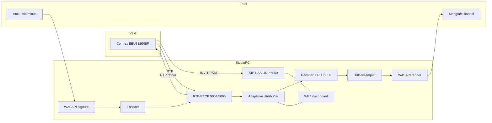
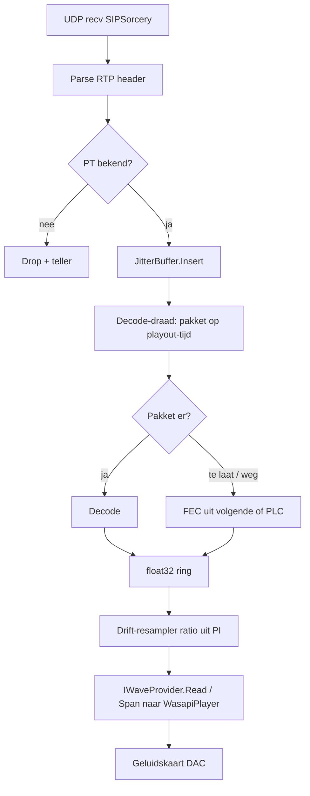
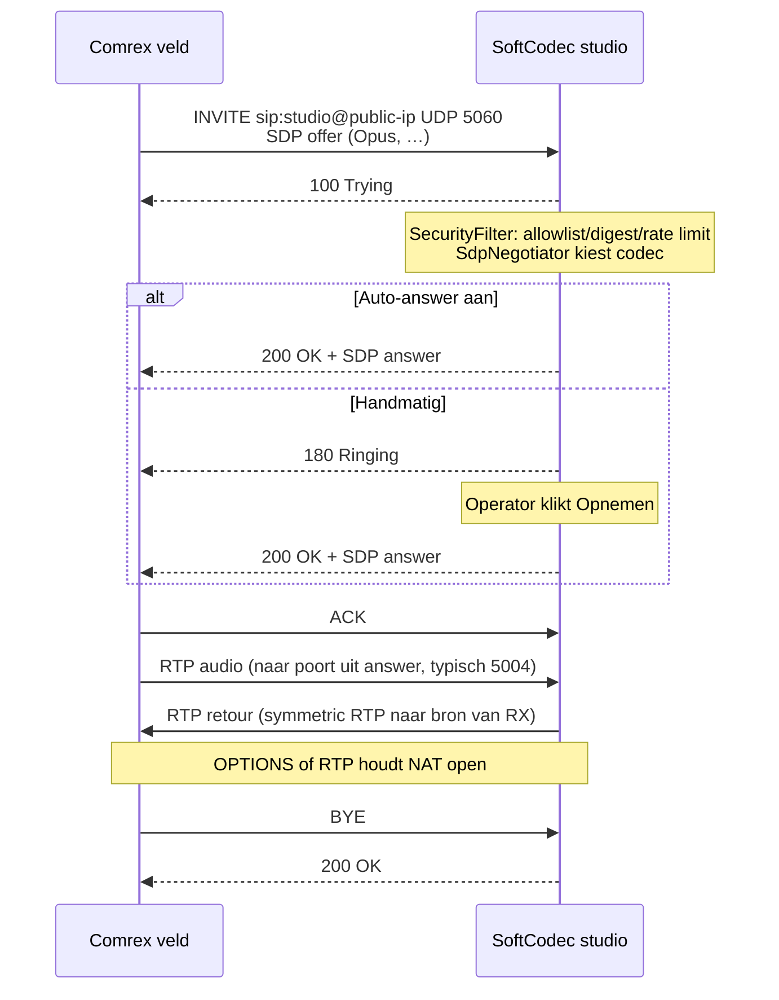
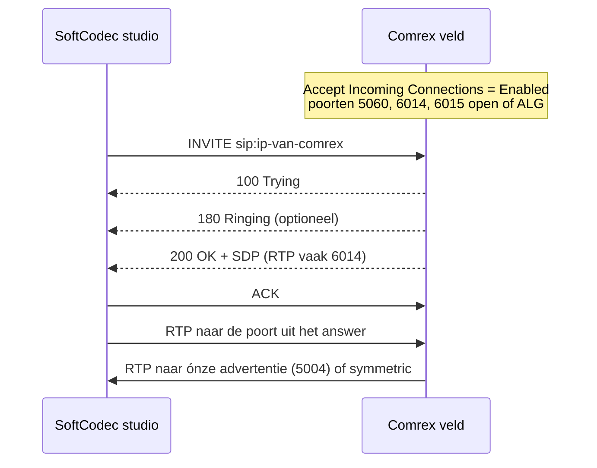

# SoftCodec — Technisch ontwerp

**Versie:** 1.0  
**Datum:** 10 november 2026 (Europe/Amsterdam)  
**Status:** ontwerp ter implementatie  
**Opdrachtgever:** Jeroen, DVC-it  
**Gebruikerscontext:** Radio Aa en Hunze — ontvangst van live-reportages vanuit het veld  
**Gerelateerd project:** REA-Radio-DJ (`C:\dev\REA-Radio-DJ`, C# / .NET 9)  
**Auteur van dit document:** Kiwi (ontwerp in opdracht van Jeroen)

Dit document beschrijft een zelfstandige, installeerbare Windows-applicatie (softcodec) die in de studio een hardware-codec vervangt: hij neemt EBU Tech 3326-gesprekken (N/ACIP, SIP + RTP) aan van veldcodecs, speelt de ontvangen audio uit via een gekozen geluidskaart naar de mengtafel, en stuurt een mix-minus terug via RTP. De mediakern is een herbruikbare bibliotheek, zodat dezelfde stack later in REA-Radio-DJ kan worden ingebed.

Waar iets niet hard uit een specificatie of uit actuele packagedocumentatie volgt, staat dat expliciet als *onzeker* of *te verifiëren bij implementatie*.

---

## Inhoud

1. [Doelen en niet-doelen](#1-doelen-en-niet-doelen)
2. [Eisen](#2-eisen)
3. [Oplossingsstructuur](#3-oplossingsstructuur)
4. [Architectuur](#4-architectuur)
5. [SIP en SDP](#5-sip-en-sdp)
6. [Beveiliging](#6-beveiliging)
7. [Datamodel, configuratie, logging en alarmen](#7-datamodel-configuratie-logging-en-alarmen)
8. [Grafische interface](#8-grafische-interface)
9. [Kernklassen en hot-path](#9-kernklassen-en-hot-path)
10. [Installer, netwerk en uitrol](#10-installer-netwerk-en-uitrol)
11. [Teststrategie](#11-teststrategie)
12. [Integratie in REA-Radio-DJ](#12-integratie-in-rea-radio-dj)
13. [Roadmap, risico’s en licenties](#13-roadmap-risicos-en-licenties)
14. [Bronnen](#14-bronnen)
15. [Bijlagen](#15-bijlagen)

---

## 1. Doelen en niet-doelen

### 1.1 Probleem

Radio Aa en Hunze wil live-audio uit het veld (reportage, uitzending op locatie) in de studio ontvangen zonder een aparte hardware-studiocodec te hoeven plaatsen. Jeroen bouwt hiervoor een Windows-applicatie die je op een studiopc installeert, waarna je in de router poorten doorzet naar die pc. De gedecodeerde audio gaat via een gekozen uitgang van de geluidskaart de mengtafel in. De aux of mix-minus van de tafel komt terug op een ingang van dezelfde (of een tweede) kaart, en gaat als retourstroom naar de verslaggever.

 Dezelfde kern moet later als live remote-ingang in REA-Radio-DJ dienen.

### 1.2 Doelen

- Een installeerbare Windows-desktopapp (grafische interface) die 24/7 in de studio kan draaien.
- Binnenkomende én uitgaande gesprekken volgens **EBU Tech 3326** (N/ACIP): SIP volgens RFC 3261 voor bidirectionele sessies, RTP/UDP volgens RFC 3550 en RFC 3551 voor media, SDP volgens RFC 4566, codeconderhandeling volgens RFC 3264.
- Primaire interoperabiliteit met Comrex **ACCESS** en **BRIC-Link** (en BRIC-Link II) in het profiel **EBU 3326/SIP** — niet in hun standaardmodus.
- Audio-uitgang naar een door de gebruiker gekozen WASAPI-apparaat (shared of exclusive), later optioneel ASIO.
- Mix-minus-retour via een gekozen capture-apparaat, gecodeerd en terugverstuurd over RTP.
- Herbruikbare mediakern (`SoftCodec.Core` en satellietprojecten) zonder WPF-afhankelijkheden, geschikt voor inbedding in REA-Radio-DJ.
- Duidelijke status, VU-meters, netwerkstatistieken, opname, alarmen en profielen per verslaggever.
- Veilige standaardconfiguratie: digestsleutel of IP-allowlist, rate limiting, bescherming tegen SIP-scanners.
- Efficiënte realtime hot-path: zo min mogelijk allocaties, voorspelbare latency, expliciete behandeling van klokdrift tussen zender en geluidskaart.

### 1.3 Niet-doelen

De volgende zaken zitten **bewust niet** in deze software, omdat ze niet open gespecificeerd zijn of tot een ander product behoren:

| Onderwerp | Waarom niet |
| --- | --- |
| **Comrex BRIC Normal** | Eigen transportprotocol van Comrex. De details zijn niet openbaar. Een eigen implementatie zou reverse-engineering vereisen en is juridisch én technisch ongewenst. |
| **Comrex CrossLock** | Propriëtaire bonding-/FEC-/multinetwerklaag bovenop BRIC. Zonder CrossLock is de verbinding over slecht 4G merkbaar minder robuust; dat is een geaccepteerde ruil voor open interoperabiliteit. |
| **Comrex Switchboard** | Cloud-hulp bij NAT/aanwezigheid, gekoppeld aan het propriëtaire ecosysteem. Niet bruikbaar vanuit een EBU 3326-softcodec. |
| **Comrex Opal** | Opal is een *Web Audio Gateway* op basis van **WebRTC in de browser** (Opus, TLS, eigen poorten TCP 80/443/8082 en UDP 16390–16393). Het is géén EBU 3326/SIP-eindpunt. Browserbellers horen in een apart (later) spoor thuis, niet in deze SIP-app. |
| **Contactclosures / ancillary data van Comrex** | De BRIC-Link II-handleiding stelt dat ancillary data, contactclosures, Switchboard TS, multistreaming en multicast in N/ACIP SIP-modus **niet** ondersteund worden. EBU Tech 3368, annex C, laat ancillary data bewust open. |
| **Asymmetrische codecs per richting naar Comrex** | Comrex documenteert dat N/ACIP SIP-gesprekken bij hen **altijd symmetrisch** zijn (geen verschillende encoders per richting). Onze kern kán later asymmetrische profielen volgens Tech 3368 aan, maar de eerste interoperabiliteit met Comrex is symmetrisch. |
| **Volledige EBU 3326-certificatie in v1** | Tech 3326 verplicht o.a. MPEG-1/2 Layer II. Comrex zelf implementeert Layer II niet (en voldoet daardoor zelf niet volledig). Voor Radio Aa en Hunze is Comrex-interop het doel, geen sticker. Layer II en AAC komen in een later spoor, met licentie-afweging. |
| **ICE/TURN als harde eis** | Tech 3326 noemt STUN/ICE niet. Comrex-SIP werkt met poortforward en/of SIP ALG, niet met een volledige ICE-agent. Wij doen wél public-IP-advertentie, symmetric RTP, keepalives en optioneel STUN. |
| **Meerdere gelijktijdige gesprekken in v1** | Eén actieve sessie. De interfaces houden rekening met uitbreiding. |
| **Softwarematige akoestische echo canceller als vervanging van mix-minus** | Mix-minus hoort van de mengtafel te komen. Optionele AEC is hooguit een vangnet in een later stadium, nooit het ontwerp. |

### 1.4 Uitgangspunt voor Comrex

Aan de veldkant maakt de verslaggever een uitgaand profiel met:

- *Channel* = **EBU 3326/SIP** (niet BRIC Normal);
- een encoder die wij ondersteunen: bij voorkeur **Opus**, anders G.722, G.711 of L16;
- als bestemming het publieke IP-adres (of de DNS-naam) van de studio, poort 5060/UDP tenzij anders geconfigureerd.

Firmware: Opus op ACCESS/BRIC-Link zit erin vanaf firmware **3.0**. Oudere firmware valt terug op G.722, G.711 of AAC/L16. In de Comrex-UI heette dit onder firmware onder 4.0 nog *N/ACIP SIP Settings*.

Standaard RTP/RTCP-poorten **op een Comrex die zelf ontvangt** zijn volgens Comrex UDP **6014 / 6015**. Onze app volgt de EBU-aanbeveling en adverteert standaard **5004 / 5005**. Dat is geen probleem: de poorten staan in het SDP en de andere kant stuurt daar naartoe.

Comrex raadt soms een SIP ALG op de router aan als poortforward lastig is. **Aan de studiokant zetten we SIP ALG uit** en gebruiken we expliciete poortforwards. ALG’s herschrijven SDP regelmatig fout en veroorzaken eenzijdige audio.

---

## 2. Eisen

### 2.1 Functioneel

**Signalering**

- F-SIP-1: Als UAS (studio ontvangt) luisteren op configureerbare SIP-poort, standaard UDP 5060 (verplicht default volgens EBU Tech 3326 §4.3.1).
- F-SIP-2: Ondersteun de SIP-methoden **INVITE, ACK, BYE, OPTIONS** (verplicht) en **REGISTER** (verplicht door Tech 3326, in de UI optioneel in te schakelen — de studiomodus is in eerste instantie registrar-loos).
- F-SIP-3: Offer/answer volgens RFC 3264. De gebruiker kan codecprioriteit instellen (Tech 3326 §4.3.2).
- F-SIP-4: Registrar-loos direct bellen: `sip:studio@<publiek-ip>` of `sip:<publiek-ip>`.
- F-SIP-5: Optioneel registreren bij een externe SIP-registrar/proxy, inclusief outbound proxy (Tech 3326 §4.3.1).
- F-SIP-6: Re-INVITE voor heronderhandeling volgens RFC 3261 / RFC 3264. EBU Tech 3326 §4.3.3 formuleert dit informeel (“de ontvanger antwoordt met ACK”); de canonieke flow is re-INVITE → 200 OK → ACK. Nieuwe media pas toepassen ná voltooiing van offer/answer.
- F-SIP-7: OPTIONS beantwoorden met 200 OK (keepalive én verplicht door de spec). Periodiek zelf OPTIONS (of CRLF-keepalive) sturen ter NAT-binding.
- F-SIP-8: Uitgaande gesprekken naar een Comrex of softphone, met hetzelfde mediapad.
- F-SIP-9: Configureerbare timers: geen media gedurende N seconden (standaard 20 s) verbreekt het gesprek; maximale gespreksduur (standaard uit); geen ACK na 200 OK volgt RFC 3261 Timer H (64·T1 = 32 s bij standaard T1 = 500 ms).
- F-SIP-10: Optioneel SIP session timers (RFC 4028). *Of Comrex dit honoreert is onzeker*; als de overkant het niet ondersteunt, gewoon doorgaan zonder.

**Media**

- F-MED-1: RTP over UDP, UDP-checksum aan (Tech 3326 §2.2.1).
- F-MED-2: Standaard RTP 5004 en RTCP 5005 (Tech 3326 §2.2.5). Configureerbaar bereik, bijvoorbeeld 5004–5010. Extra kanalen volgens het EBU-schema +10 (5014/5015, …) reserveren we, maar v1 heeft één stereo- of monostroom.
- F-MED-3: RTCP Sender Report en Receiver Report meesturen en ontvangen (aanbevolen door Tech 3326). Gebruik de rapporten voor RTT, loss en jitter in de UI.
- F-MED-4: Symmetric RTP: stuur retour-RTP naar het bronadres en de bronpoort van het *eerst ontvangen* mediapakket, niet blind naar het adres in het SDP. Dit is essentieel achter NAT. (Gedrag dat veel codecs in de praktijk hanteren; het staat niet als MUST in Tech 3326.)
- F-MED-5: Adaptieve jitterbuffer, configureerbaar minimum en maximum (standaard 60–400 ms, begindoel 120 ms). Statische modus ook mogelijk.
- F-MED-6: Klokdriftcompensatie tussen RTP-zendklok en lokale deviceklok (zie §4.5).
- F-MED-7: Packet Loss Concealment, bij Opus inclusief in-band FEC (RFC 7587 / RFC 6716).
- F-MED-8: Mix-minus-pad: capture → resample naar codecklok → encode → RTP TX. De gedecodeerde remote mag *nooit* in dit pad lekken.
- F-MED-9: Keuze van weergave- én capture-apparaat, inclusief kanaaltoewijzing (bijvoorbeeld alleen links van een stereo-interface).
- F-MED-10: WASAPI exclusive en shared. Exclusive + raw mode is de studiostandaard. Shared met `IAudioClient3`-low-latency als fallback.
- F-MED-11: Opname van de ontvangen remote, optioneel van de retour, naar WAV (PCM, 24-bit/48 kHz voorkeur) en later FLAC.
- F-MED-12: Stiltealarm en linkverliesalarm, met visuele + configureerbare actie (geluid, log, later webhook).

**Codecs (v1 versus later)**

| Codec | EBU Tech 3326 | Comrex SIP | SoftCodec v1 | Opmerkingen |
| --- | --- | --- | --- | --- |
| Opus | Optioneel (§3.3.3); payload nu RFC 7587 (de spec uit 2014 noemde nog een draft) | Ondersteund (firmware ≥ 3.0). Vermijd de speciale *Opus CBR*-modi; die zijn volgens Comrex bedoeld voor Tieline | **Ja, voorkeur** | `a=rtpmap:` altijd `opus/48000/2` |
| G.722 | Verplicht | Ja | **Ja** | RTP-klok **8 kHz** ondanks 16 kHz audio (RFC 3551; Tech 3326 wijst hierop, met een tikfout “RFC3351”) |
| G.711 PCMA (A-law) | Verplicht | Ja (G.711) | **Ja** | PT 8, 8 kHz, 64 kbit/s |
| G.711 PCMU (μ-law) | Verplicht | Ja (G.711) | **Ja** | PT 0, vooral voor buitenlandse VoIP-peers |
| L16 (16-bit PCM) | Verplicht voor algemene contribution-units; optioneel voor portable | Ja (“16-bit Linear PCM”) | **Ja** | 32 en 48 kHz; default ptime 4 ms; dynamisch PT |
| L24 / L20 | 24- en 20-bit via RFC 3190, verplicht-achtig in §3.1.5 voor non-portable | Onzeker of Comrex L24 in SIP aanbiedt | L24 in v1 meenemen als decoder/encoder; L20 later indien nodig | 12-bit (DAT12) overslaan |
| MPEG Layer II | Verplicht | **Nee** — Comrex voldoet hier niet aan Tech 3326 | Niet in v1 | Later, met encoder zoals TwoLAME (LGPL) |
| AAC / AAC-LD / HE-AACv2 | Aanbevolen / optioneel | Ja, AAC-familie | **Niet in v1** | Patent-/licentiecheck nodig vóór distributie |
| aptX | Aanbevolen | Niet relevant voor dit doel | Nee | Propriëtaire familie |
| MPEG Layer III | Optioneel | Nee (niet nodig) | Nee | |

**Overig functioneel**

- F-UI-1: Dashboard met gespreksstatus, VU, bufferdiepte, loss, jitter, bitrate, RTT.
- F-UI-2: Instellingen voor netwerk, audio, beveiliging, codecs, profielen.
- F-UI-3: Contacten/profielen per verslaggever (zie §7).
- F-UI-4: Live logviewer met filter.
- F-UI-5: Systeemvakpictogram, minimale UI tijdens uitzending, altijd-boven-optie.
- F-CFG-1: JSON-configuratie, atomisch wegschrijven, gegarandeerd herstelbaar na crash.
- F-INT-1: Publieke C#-API zodat REA-Radio-DJ de kern host zonder de WPF-app.

### 2.2 Niet-functioneel

**Latencybudget (richting veld → studio, exclusief netwerk)**

Het netwerk zelf (vooral 4G) is de grootste en minst voorspelbare term. Wat wij wél in de hand hebben:

| Stap | Doel | Toelichting |
| --- | --- | --- |
| Opus-frame (ptime) | 20 ms (instelbaar 10/20/40) | RFC 7587 default ptime is 20 ms. 10 ms is mogelijk (hogere overhead). CELT-lookahead is ongeveer 2,5 ms; SILK/hybrid tot circa 6,5 ms (*algoritmisch, vast in de codec*) |
| Jitterbuffer doel | 80–160 ms op vaste lijn; 120–250 ms op 4G | Adaptief binnen min/max |
| Decode + PLC | < 3 ms | Native Opus (Concentus.Native) op de studiopc |
| Drift-resampler | < 1 ms extra | Zeer kleine ratio-afwijking |
| WASAPI exclusive uit | 5–15 ms | `WasapiPlayerBuilder.WithExclusiveMode().WithLatency(10)` als startpunt, meten per interface |
| Capture mix-minus | 5–15 ms | Spiegelbeeld |
| Encode retour | gelijk aan ptime + lookahead | Symmetrisch |

Richtwaarde voor een gesprek (heen én terug, inclusief twee keer netwerk):

- Vaste, goede internetlijn: round-trip **150–300 ms** is haalbaar en prettig voor een interview.
- 4G: **300–700 ms** komt voor. Dat is gesprekbaar, maar vraagt discipline (niet door elkaar praten). Grotere jitterbuffer maakt het stabieler en het gesprek trager.
- Boven circa 500 ms eenzijdige vertraging wordt een interview vermoeiend. De UI toont de geschatte one-way delay (buffer + ptime + lokale I/O; netwerk-RTT/2 uit RTCP als die er is).

**CPU en geheugen**

- Op een moderne studiopc (Jeroens machine — Ryzen 9 9950X3D, 92 GB RAM, RTX 5080 — is ver overgedimensioneerd; we ontwerpen alsof het een stille i5-kantoorpc is) moet de mediakern in rust onder **8 % van één kern** blijven, tijdens een Opus 48 kHz stereo 128 kbit/s-gesprek typisch onder **15 % van één kern**.
- Werkgeheugen van het proces: doel < 200 MB resident in normaal bedrijf, exclusief logs.
- Native Opus via `Concentus.Native` is de voorkeur. De managed Concentus-poort is volgens de auteur ongeveer 40–50 % van de snelheid van libopus; dat is op een studiopc nog steeds realtime, maar native geeft meer marge en minder jitter in de decode-draad.
- Geen GC-pieken op de renderdraad: preallocatie, `ArrayPool<T>`, geen LINQ/stringwerk in de hot-path.

**Betrouwbaarheid en 24/7**

- Onbeheerd uren tot dagen achter elkaar stabiel (soaktest 7 × 24 uur als vrijgavecriterium).
- Automatisch herstarten bij crash (Taakplanner “bij aanmelding” + herstart bij falen).
- Geen audio als Windows-service in sessie 0 — zie §3.4.
- Na netwerkdrop van de overkant: nette teardown, duidelijke status, klaar voor het volgende gesprek zonder herstart.
- Configuratiewijzigingen die geen herstart van Windows vragen; wijziging van bind-poort of NIC wél een herstart van de SIP-transportlaag (zonder de app te sluiten).

**Overige NF**

- Windows 10 21H2 of nieuwer, en Windows 11; x64. (WASAPI raw: Windows 8.1+; `IAudioClient3` low-latency shared: Windows 10 1607+.)
- .NET 9, in lijn met REA-Radio-DJ.
- Taal van de UI: Nederlands, met technische termen (SIP, RTP, jitter) onvertaald waar dat in de omroepgangbaar is.
- Logs never containing passwords or digest HA1.
- Bepaalbaarheid: één actieve mediaklok, één duidelijke “on air”-toestand.

### 2.3 Acceptatiecriteria voor een eerste productieversie

1. Een Linphone- of baresip-client kan met Opus (en apart met G.722) inbellen en bidirectioneel audio uitwisselen.
2. Een Comrex ACCESS of BRIC-Link in EBU 3326/SIP-profiel met Opus kan hetzelfde, getest op zowel LAN als via internet met poortforward.
3. Mix-minus lekt de remote niet terug (luistertest + correlatiemeting).
4. Bij kunstmatig 5 % willekeurig pakketverlies blijft spraak verstaanbaar (Opus FEC + PLC).
5. Bij een kunstmatige klokafwijking van circa 100 ppm geen hoorbare clicks over een uur (alleen een langzame, onhoorbare timescale).
6. Onbekende internethosts kunnen niet ongeautoriseerd een gesprek opzetten (allowlist of digest).
7. De app overleeft een soaktest van 24 uur zonder geheugenlek boven een afgesproken drempel (bijvoorbeeld +30 MB) en zonder audio-glitch door GC.

---

## 3. Oplossingsstructuur

### 3.1 Solution-overzicht

Eén Visual Studio-solution `SoftCodec.sln`, SDK-style projecten, `net9.0` voor de bibliotheken en `net9.0-windows` voor de WPF-app. Directoryvoorbeeld:

```
SoftCodec/
  SoftCodec.sln
  src/
    SoftCodec.Core/          # sessie, profielen, statistieken, abstracties
    SoftCodec.Sip/           # SIP-transport, digest, allowlist, SDP-bouw
    SoftCodec.Rtp/           # RTP/RTCP-parsing bovenop of naast SIPSorcery
    SoftCodec.Audio/         # jitter, decode/encode, resampler, drift, devices
    SoftCodec.App/           # WPF-schil, MVVM, installer-host
    SoftCodec.Watchdog/      # optioneel: klein hulpproces, géén audio
  tests/
    SoftCodec.Tests/         # unit
    SoftCodec.Tests.Integration/
  installer/
    SoftCodec.iss            # Inno Setup
    firewall.ps1
  docs/
    ONTWERP.md
```

`SoftCodec.Rtp` mag fysiek in `SoftCodec.Sip` leven als de grens kunstmatig blijkt; conceptueel blijft RTP een eigen laag zodat de audio-pipeline geen SIP-types ziet.

### 3.2 Projectverantwoordelijkheden

| Project | Rol | Referenties |
| --- | --- | --- |
| `SoftCodec.Core` | Domein: `CallSession`, codec-onderhandeling als puur model, statistieken, configuratie-POCOs, alarmen, opname-orchestratie. Geen Windows-forms, geen NAudio, geen SIPSorcery-types lekken naar buiten via de publieke façade | alleen BCL + Microsoft.Extensions.* + Serilog.Abstractions |
| `SoftCodec.Sip` | `SIPTransport`, UAS/UAC, REGISTER, security-filter, SDP offer/answer | SIPSorcery |
| `SoftCodec.Audio` | Devices, codecs, jitterbuffer, drift, mix-minus-guard | NAudio 3, Concentus, Concentus.Native |
| `SoftCodec.App` | WPF UI, system tray, auto-start-registratie | WPF, CommunityToolkit.Mvvm |
| `SoftCodec.Watchdog` | Optionele console/service die alleen kijkt of `SoftCodec.App` nog leeft en hem herstart | geen audio-API’s |
| `SoftCodec.Tests` | Unit tests met testdoubles voor tijd, UDP en devices | xUnit, FluentAssertions, NSubstitute |

### 3.3 Waarom WPF, en niet WinUI of Avalonia

| | WPF (.NET 9) | WinUI 3 | Avalonia |
| --- | --- | --- | --- |
| Volwassenheid desktop | Zeer hoog, decennia omroep- en studio-apps | Jonger, packaging (Windows App SDK) blijft schuren | Hoog, maar extra UI-stack |
| Past bij REA-Radio-DJ | Zelfde C#/.NET 9-wereld; MVVM is bekend | Ander XAML-dialect | Kruisplatform dat we niet nodig hebben |
| Audio + tray + always-on | Ongecompliceerd: NotifyIcon, hook op sessie-einde, geen sandbox | MSIX wordt sterk gepusht; unpackaged kan, maar extra bewegende delen | Kan, geen winst |
| Installer | Klassiek Inno Setup / MSI, firewall via `netsh`, Program Files | MSIX-capabilities voor raw sockets en exclusive audio zijn extra werk | Zelfde als WPF |
| Look | Minder “Windows 11 fluent” out of the box | Mooier standaard | Flexibel |

**Keuze: WPF op `net9.0-windows`.** De winst van WinUI (moderne controls) weegt niet op tegen verpakkingsrisico’s voor een 24/7-studiotool die raw UDP, firewallregels en exclusive WASAPI nodig heeft. Avalonia voegt niets toe zolang we geen Linux/macOS-studio ondersteunen. De mediakern blijft UI-agnostisch; een later WinUI-front is daardoor geen herschrijving van het moeilijke deel.

### 3.4 Waarom géén Windows-service voor audio

Een Windows-service draait in **sessie 0**. Sinds Vista is die sessie geïsoleerd van de interactieve gebruikerssessie. WASAPI-eindpunten van de aangemelde gebruiker (de USB-interface naar de mengtafel) zijn vanuit sessie 0 niet betrouwbaar te openen. “Allow service to interact with desktop” lost dit op moderne Windows niet op.

Daarom:

- `SoftCodec.App` is het proces dat audio én SIP doet. Het start bij aanmelding van de studio-account (Taakplanner of map Opstarten), minimaliseert naar het systeemvak, en herstart bij een niet-nul-exit.
- Een optionele `SoftCodec.Watchdog` mag als taak of zelfs als service draaien, maar doet uitsluitend: “leeft het app-proces, zo niet start het opnieuw in de gebruikerssessie”. Geen sockets, geen WASAPI.
- De studiopc heeft bij voorkeur een dedicated account dat automatisch aanmeldt (fysiek afgeschermde ruimte) of een interactieve sessie die niet uitlogt.

### 3.5 NuGet-afhankelijkheden

Versies hieronder zijn de actuele stabiele releases op het moment van dit ontwerp (10 november 2026) en moeten bij implementatie opnieuw worden vastgepind (`Directory.Packages.props`).

| Package | Waar | Licentie | Gebruik |
| --- | --- | --- | --- |
| `SIPSorcery` (nu 10.0.17) | Sip | BSD 3-Clause **plus extra BDS-beperking** (zie §13.3) | `SIPTransport`, `SIPUserAgent`, `RTPSession`, SDP |
| `SIPSorceryMedia.Abstractions` | Audio/Sip | zelfde familie | `IAudioSource` / `IAudioSink` als we die brug gebruiken |
| **Niet** `SIPSorceryMedia.Windows` als primaire I/O | — | — | Die stack is op VoIP-gesprekken gericht. Wij bouwen onze eigen pipeline met NAudio 3 en gebruiken SIPSorcery voor signalering + RTP-transport |
| `SIPSorceryMedia.Encoders` | optioneel | let op: FFmpeg-variant is LGPL | Alleen raadplegen; G.711/G.722 zitten al in de hoofdlibrary. **Niet** de FFmpeg-package trekken tenzij we dat bewust willen |
| `NAudio` 3.3.0 | Audio | MIT | Meta-package: `NAudio.Core`, `NAudio.Wasapi`, `NAudio.WinMM`, `NAudio.Midi` |
| `NAudio.Wasapi` 3.3.0 | Audio | MIT | `WasapiPlayer` / `WasapiPlayerBuilder`, `WasapiRecorder` / `WasapiRecorderBuilder` |
| `NAudio.Asio` | Audio, later | MIT op de wrapper; **Steinberg ASIO SDK-voorwaarden** voor distributie | Alleen fase “ASIO”, niet in v1 |
| `Concentus` 2.2.2 | Audio | Opus-licentie (BSD-stijl, zie upstream LICENSE) | `OpusCodecFactory`, plus de meegeleverde Speex-resampler |
| `Concentus.Native` 1.5.2 | Audio | zelfde familie | Automatische native versnelling van encode/decode |
| `CommunityToolkit.Mvvm` | App | MIT | `ObservableObject`, `[RelayCommand]`, `ObservableProperty` |
| `Microsoft.Extensions.Hosting` | App, Core | MIT | Generic host, DI, lifetime |
| `Microsoft.Extensions.Configuration.Json` | Core | MIT | config.json |
| `Microsoft.Extensions.Options` | Core | MIT | typed options |
| `Serilog` + `Serilog.Sinks.File` + `Serilog.Sinks.Debug` + `Serilog.Extensions.Hosting` | App | Apache-2.0 | gestructureerde logs |
| `System.IO.Pipelines` | Audio | MIT | optioneel voor byte-pipelines; Channels uit de BCL volstaan vaak |
| `xunit`, `FluentAssertions`, `NSubstitute` | Tests | Apache-2.0 / Apache-2.0 / BSD | testen |

 bewuste afwijzingen:

- Geen `NAudio.Lame` (MP3) voor opname; WAV/FLAC horen bij contribution.
- Geen complete WebRTC-stack. SIPSorcery kán WebRTC, maar dat is het Opal-spoor, niet v1.
- Geen zelfgeschreven SIP-parser.

### 3.6 Target frameworks en interfacestijl

- Bibliotheken: `net9.0` (zonder `-windows`) waar mogelijk, zodat unit tests op elke host draaien. Devicecode krijgt `[SupportedOSPlatform("windows")]` of leeft in een `net9.0-windows`-assembly.
- `SoftCodec.App`: `net9.0-windows`, `UseWPF=true`, `PlatformTarget=x64`.
- Nullable reference types aan, behandel warnings as errors in Core/Audio/Sip.
- Publieke API van `SoftCodec.Core` is async waar I/O wacht, synchroon en allocatievrij waar audio tikt.

---

## 4. Architectuur

### 4.1 Blokoverzicht

```
                    ┌──────────────────────────────────────────────┐
   Verslaggever     │                 SoftCodec.App (WPF)          │
   Comrex           │  Dashboard VM   Instellingen   Logs   Tray   │
   ACCESS /         └─────────────┬────────────────────────────────┘
   BRIC-Link                      │ ISoftCodecHost / events
                    ┌─────────────▼────────────────────────────────┐
                    │              SoftCodec.Core                  │
                    │  CallController  ProfileStore  MetricsHub    │
                    │  AlarmMonitor   RecordingSession             │
                    └─────┬───────────────────────────┬────────────┘
                          │                           │
              ┌───────────▼──────────┐    ┌───────────▼────────────┐
              │    SoftCodec.Sip     │    │    SoftCodec.Audio     │
              │ SIPTransport         │    │ DeviceGraph            │
              │ UserAgent (UAS/UAC)  │    │ RxPipeline / TxPipeline│
              │ SdpNegotiator        │    │ JitterBuffer           │
              │ SecurityFilter       │    │ CodecSet / Resampler   │
              │ RTPSession (sockets) │    │ DriftController        │
              └──────────┬───────────┘    └──────────▲─────────────┘
                         │  RTP payload               │ PCM frames
                         └────────────►───────────────┘
                          UDP 5060 SIP
                          UDP 5004 RTP / 5005 RTCP
                                          │
                                          ▼
                                   WASAPI exclusive
                                   uit → mengtafel
                                   in  ← mix-minus
```

De pijl **van SIP/RTP naar Audio is payload + timing, geen device-handle**. `RTPSession` van SIPSorcery blijft verantwoordelijk voor UDP-sockets, sequence numbers, SSRC en RTCP. Zodra een RTP-pakket binnen is, gaat alleen de payload plus header-metadata (`sequence`, `timestamp`, `payloadType`, `ssrc`, aankomsttijd QPC) de jitterbuffer in.

We gebruiken **niet** `VoIPMediaSession` + `WindowsAudioEndPoint` als audiopad. Die route is prima voor een softphone, maar geeft ons geen professionele jitterbuffer, geen driftregelaar en geen strikte mix-minus. Wel hergebruiken we SIPSorcery’s `SIPUserAgent` (of een dunne schil eromheen) en `RTPSession.SendAudio` / `OnRtpPacketReceived`.

### 4.2 Mermaid — componenten



### 4.3 Mermaid — receive-pipeline



### 4.4 Threadingmodel

| Draad | Prioriteit | Wat wel | Wat niet |
| --- | --- | --- | --- |
| WPF UI (STA) | Normaal | Binding, knoppen, logweergave via `IProgress` / `SynchronizationContext` | Geen decode, geen socket-recv verwerken voorbij “post event” |
| SIPTransport (SIPSorcery) | Normaal | Parse SIP, transacties, dialog | Geen audio |
| RTP receive (SIPSorcery socket) | Boven normaal | Header lezen, kopie van payload in gepoolde slot, insert jitterbuffer | Geen decode, geen GC-gevoelige alloc als het slot preallocated is |
| Decode / jitter playout | Hoog + MMCSS `"Pro Audio"` indien een eigen draad | Decode, PLC, schrijven naar PCM-ring, statistieken lock-vrij ophogen | Geen file I/O, geen locks die de UI of capture vasthouden |
| WASAPI render (NAudio `WasapiPlayer`) | MMCSS `"Pro Audio"` (builder) | Uitsluitend kopiëren uit de geresamplede ring naar de devicebuffer | **Nooit** Opus decoderen in `Read()` |
| WASAPI capture (`WasapiRecorder`) | MMCSS `"Pro Audio"` | Span van de devicebuffer naar capture-ring kopiëren | Niet encoderen in de callback |
| Encode / RTP TX | Hoog | Als `ptime` samples klaar zijn: encode, `SendAudio` | Geen UI |
| Metrics / alarms (1 Hz) | Laag | Steekproef van lock-vrije tellers, Serilog, stilte-RMS | — |
| Recording | Laag, eigen bounded channel | WAV/FLAC schrijven vanaf een kopie | Mag nooit de renderdraad blokkeren |

Communicatie tussen draden:

- `System.Threading.Channels.Channel<T>` met `SingleReader = true`, `SingleWriter = true` waar mogelijk, `FullMode = DropOldest` of een vast ringbuffer-gedrag — nooit onbegrensd laten groeien.
- Voor PCM: lock-vrije SPSC-ring (`float[]` preallocatie, `Volatile` head/tail of `SequenceEqual`-vrije counters).
- Voor RTP-slots: vast array van N slots geïndexeerd op `timestamp / frameSize` modulo de bufferdiepte, plus een bitmap “bezet”.

`timeBeginPeriod(1)` / `timeEndPeriod(1)` alleen overwegen als we zelf een multimedia-timer nodig hebben. WASAPI event-sync is te verkiezen boven een periodieke timer. Als we hem wél zetten, paarwijs weer uitzetten.

### 4.5 Audio-pipeline in detail

#### Ontvangst (veldcodec → mengtafel)

1. **RTP RX.** SIPSorcery levert het pakket. We lezen PT, seq, timestamp, marker, SSRC. Onbekende SSRC na de start van de sessie: tellen, niet crashen; na onderhandeling is de verwachte SSRC bekend maar CSRC moet genegeerd kunnen worden (Tech 3326 §2.2.4).
2. **Duplicate detectie.** RFC 7587: duplicaten mogen voorkomen; hoogstens één payload naar de decoder. Sequence-number set of “laatst gezien per timestamp”.
3. **Jitterbuffer insert.** Opslaan op RTP-timestamp, niet op aankomsttijd. Te oude pakketten (achter de playout-punt) tellen als *late* en gaan weg. Te verre toekomst (voorbij max delay) tellen als *overflow* en kunnen een bufferreset forceren.
4. **Playout.** De decode-draad houdt een playout-timestamp bij. Als het fiestduurtijd-pakket er is: decoderen. Zo niet:
   - Als Opus in-band FEC aanstaat én het *volgende* pakket al binnen is: decodeer dat pakket met `fecFlag = true` om het ontbrekende frame te reconstrueren (RFC 7587 §3.3). Daarna het volgende pakket normaal decoderen.
   - Anders: PLC — bij Opus `Decode(ReadOnlySpan<byte>.Empty, pcm, frameSize, fec: false)` oftewel een lost-packet-call; de decoder genereert een schatting.
5. **Resample naar deviceformat.** Intern werken we op **48 kHz, float32, interleaved**. G.722 (16 kHz) en G.711 (8 kHz) worden na decode opgewaardeerd met de Speex-resampler uit Concentus. De device in exclusive mode zetten we bij voorkeur zelf op 48 kHz. In shared mode resamples WASAPI eventueel nogmaals; dat accepteren we als fallback, maar exclusive + native 48 kHz is de studiostandaard.
6. **Driftcompensatie.** Zie §4.6.
7. **WASAPI render.** `WasapiPlayerBuilder` met `.WithDevice(...)`, `.WithExclusiveMode()` (of shared + `.WithLowLatency()`), `.WithEventSync()`, `.WithLatency(10)` als start, `.WithMmcssThreadPriority("Pro Audio")`, `.WithRawMode()` om Windows-audioverbeteringen (luidheidsvergelijking, ruimtelijk, downmix) te omzeilen. Raw mode vereist `IAudioClient2` (Windows 8.1+) en gooit anders `InvalidOperationException` — dat vangen we en tonen we als waarschuwing.
8. **Uitgang naar de tafel.** Fysiek: lijnuitgang van de interface naar een lijningang van het mengpaneel.

`WasapiOut` bestaat nog in NAudio 3 maar is legacy. Nieuwe code gebruikt `WasapiPlayer`.

#### Retour (mengtafel mix-minus → veldcodec)

1. **WASAPI capture** via `WasapiRecorderBuilder` met het gekozen capture-apparaat, exclusive of shared, raw mode, MMCSS `"Pro Audio"`, event-sync. De `DataAvailable`-span is alleen geldig tijdens de callback: direct kopiëren naar de capture-ring.
2. De callback krijgt tevens `devicePosition` en `qpcPosition` — gebruiken om gaten te zien (USB-glitch) en om de captureklok te relateren aan QPC.
3. **Encode-draad** verzamelt `ptime` aan samples (bij Opus 20 ms = 960 samples per kanaal bij 48 kHz), past zo nodig downmix/kanaalkeuze toe, en encodeert.
4. **RTP TX** via `RTPSession.SendAudio(durationRtpUnits, payload)`. Voor Opus is `durationRtpUnits` altijd op een 48 kHz-klok: 20 ms = 960, ongeacht of de inhoud “wideband” klinkt (RFC 7587 §4.1).
5. Symmetric RTP: destinație = laatst bekende bron van RX, zodra die bekend is; tot die tijd het SDP-adres van de overkant.

#### Mix-minus-regel

```
uitzending = (microfoons + playback + remote_uit)
mix_minus_naar_verslaggever = uitzending − remote_uit
```

Dat aftrekken doet de **mengtafel** (aux/bus zonder het remote-kanaal, of een hardware-mix-minus). De software:

- speelt `remote_uit` alleen op het gekozen render-apparaat;
- neemt alleen het gekozen capture-apparaat op;
- heeft een debug-schakelaar “loopback-test” die bewust wél de remote terugstuurt — standaard uit, met duidelijke waarschuwing;
- weigert hetzelfde exclusive device tegelijk als enige render én capture tenzij de interface dat werkelijk als full-duplex aanbiedt (de meeste USB-interfaces doen dat wél, als één duplex-ASIO/WASAPI-apparaat met aparte in- en uitgangen).

Windows AEC (`WithEchoCancellationReferenceEndpoint`, Windows 11 22621+) is **geen** vervanging. We documenteren het als experimentele noodoptie, uit in v1.

### 4.6 Klokdrift — ontwerp

Twee klokken lopen nooit gelijk:

- de sampleklok van de *zender* (de Comrex of diens interface), zichtbaar als RTP-timestamps;
- de sampleklok van de *lokale* geluidskaart, zichtbaar via `IAudioClock` / `WasapiPlayer.GetPosition()`.

Typische afwijking: **10–100 ppm** (parts per million). Bij 50 ppm en 48 kHz:

\[
\Delta N = 50 \times 10^{-6} \times 48000 \times 3600 \approx 8640\ \text{samples per uur} \approx 180\ \text{ms per uur}.
\]

Zonder compensatie loopt de jitterbuffer in een uur ofwel leeg (underruns, gaten) ofwel vol (oploopende vertraging tot reset). Dat is onacceptabel voor een uitzending.

**Meting**

- Elke 100–200 ms bekijken we de bufferbezetting \( q \) (in seconden PCM gereed vóór de device).
- Doelbezetting \( q^* \) is de huidige jitterdoelwaarde (bijvoorbeeld 0,120 s) plus een kleine vaste transportruimte.
- Fout \( e = q - q^* \).
- Daarnaast houden we de RFC 3550 interarrival-jitter \( J \) bij (appendix A.8):  
  \( D(i-1,i) = (R_i - R_{i-1}) - (S_i - S_{i-1}) \),  
  \( J \leftarrow J + (|D| - J)/16 \).  
  \( R \) in dezelfde eenheid als RTP-timestamp (omrekenen vanuit QPC).
- `WasapiPlayer.GetPosition()` geeft de werkelijk weergegeven bytes volgens de deviceklok. Die gebruiken we om te zien of de device sneller of langzamer consumeert dan we denken.

**Regelaar (PI, traag)**

\[
r = 1 + K_p e + K_i \int e\,dt
\]

- \( r \) is de resample-ratio: \( r > 1 \) betekent “lees iets sneller uit de ring” (buffer leeg laten lopen, audio microscopisch hoger/korter), \( r < 1 \) het omgekeerde.
- Clamp: in normaal bedrijf \(\lvert r - 1 \rvert \le 300 \times 10^{-6}\) (300 ppm). Tijdens inlopen na een schok tijdelijk tot 1000 ppm.
- Anti-windup op de integrator.
- \( K_p \) en \( K_i \) tunen op simulatie: de verhouding moet zo langzaam bewegen dat het als timescale onhoorbaar is (ver onder vibrato of wow & flutter). 300 ppm is 0,03 % — dat is onhoorbaar als toonhoogteverschuiving voor spraak én muziek in dit gebruik.

**Uitvoering**

- Concentus bevat een poort van de **libspeexdsp-resampler**. Die gebruiken we (kwaliteit hoog, bijvoorbeeld quality 5–7) zodat we geen extra native dependency nodig hebben voor drift. Alternatief later: `r8brain` of soxr als metingen dat rechtvaardigen.
- De resampler staat tussen PCM-ring en `IWaveProvider`. De device vraagt \( N \) frames; wij lezen ongeveer \( N \cdot r \) frames uit de ring en resamplen naar \( N \).
- Grote schokken (meer dan bijvoorbeeld 40 ms uit de buurt van \( q^* \)) lossen we niet met de resampler op maar met een eenmalige aanpassing van de jitterdoelwaarde of een enkele PLC/skip van een heel frame. De PI blijft dan met een schone lei verdergaan.

**Zendpad**

Hetzelfde probleem bestaat spiegelbeeldig: de captureklok van de studiokaart versus wat de Comrex aan de andere kant verwacht. De RTP-timestamps die wij zetten, volgen onze captureklok (toename per echte captured samples, herschaald naar de RTP-klok). De Comrex heeft zijn eigen jitterbuffer en (hopelijk) zijn eigen driftlogica. Aan onze kant:

- geen extra timescale op TX tenzij de capture-ring structureel vol of leeg loopt (USB-probleem);
- als de capture-ring toch dreigt over/under te lopen: dezelfde PI op een TX-resampler vóór de encoder.

**Wat we niet doen**

- De deviceklok “naar de zender toe” forceren (onmogelijk zonder de interface te slaven).
- Elke paar seconden een sample droppen/dupliceren — dat tikt.
- De jitterbuffer eindeloos laten groeien als “oplossing”.

### 4.7 MMCSS en prioriteiten

NAudio 3’s `WasapiPlayerBuilder.WithMmcssThreadPriority("Pro Audio")` registreert de renderdraad bij de Multimedia Class Scheduler Service via `AvSetMmThreadCharacteristics`. Hetzelfde op de recorder.

Voor onze eigen decode-draad doen we hetzelfde via P/Invoke:

```csharp
[DllImport("avrt.dll", CharSet = CharSet.Unicode)]
private static extern IntPtr AvSetMmThreadCharacteristics(string taskName, ref int taskIndex);

[DllImport("avrt.dll")]
private static extern bool AvRevertMmThreadCharacteristics(IntPtr handle);
```

`taskName`: `"Pro Audio"` (studiopad) of `"Audio"` als `"Pro Audio"` faalt. Altijd pairen met revert in `finally`. Process working set en `Process.GetCurrentProcess().PriorityClass = High` overwegen, niet `RealTime` (kan de machine bevriezen).

### 4.8 Efficiëntie op de hot-path

- Alle buffers geprealloceerd bij sessiestart (max frame 120 ms Opus = 5760 samples/kanaal; stereo float = ~46 KB per slot). RFC 7587: een RTP-payload bevat precies één Opus-pakket, tot maximaal 120 ms.
- `ArrayPool<byte>.Shared` en `ArrayPool<float>.Shared` voor incidentele groottes (SIP is koud; audio is warm — liever eigen vaste pools dan Shared, om fragmentatie en noisy-neighbor te vermijden).
- `Span<byte>` / `Span<float>` overal in decode/encode. Concentus 2.x accepteert spans.
- Geen `async` op de render- of capturecallback.
- Geen locks in `Read()`; hoogstens `Volatile.Read` van head/tail.
- Metrics: `Interlocked.Increment` op `long`-tellers.
- Logging op de hot-path: alleen via een enabled-flag en dan naar een bounded channel, nooit `string.Format` per pakket in productie.

---

## 5. SIP en SDP

### 5.1 Rolverdeling

In de typische studioklant is SoftCodec de **UAS** (User Agent Server): hij luistert, de Comrex belt in. SoftCodec kan ook **UAC** zijn voor een uitgaand gesprek (studio belt de verslaggever, of een test naar Linphone).

Tech 3326 §4.3.1 verplicht daarnaast **REGISTER**, zodat de unit bij een registrar terechtkan. We implementeren REGISTER volledig, maar zetten het standaard uit. Radio Aa en Hunze gebruikt in het basisscenario geen SIP-provider: de verslaggever belt `sip:<publiek-ip-studio>`.

Defaultpoort **5060**, wijzigbaar als een filter in de weg zit (expliciet toegestaan door de spec).

Transport in v1: **SIP over UDP**. Tech 3326 schrijft het SIP-transport niet dwingend voor. Sommige VoIP-FAQ’s raden TCP aan vanwege NAT en berichtgrootte; broadcastcodecs (inclusief Comrex) gebruiken in de praktijk UDP. TCP en SIP-TLS (5061) zijn een later spoor; zie §6.5.

### 5.2 Gespreksflow — binnenkomend (hoofdscenario)



Varianten:

- Studio hangt op: SoftCodec stuurt BYE, wacht op 200.
- Geen gemeenschappelijke codec: 488 Not Acceptable Here.
- Allowlist weigert: stilte (geen antwoord) of 403 Forbidden — configureerbaar, default **stilte tegen scanners**, 403 voor een bekende maar niet-geautoriseerde peer.
- Digest verplicht en geen/ongeldige credentials: 401 Unauthorized met `WWW-Authenticate`, daarna opnieuw INVITE met `Authorization`.
- Verkeerde Request-URI user-part terwijl we een vaste user eisen (`studio`): 404 of 403, configureerbaar. Default: accepteer elke user-part op ons IP, zodat Comrex die vaak alleen een IP belt gewoon binnenkomt.

### 5.3 Gespreksflow — uitgaand



Voor uitgaande gesprekken naar Comrex moet aan hun kant *System Settings → EBU 3326/SIP Settings → Accept Incoming Connections* op Enabled staan. Hun RTP-poort in het answer is typisch 6014, RTCP 6015 (“RTSP” in één handleiding is een tikfout; het gaat om RTCP, één poort hoger).

### 5.4 SDP-regels die we strikt volgen

Uit RFC 4566 en Tech 3326 §4.1.1:

- Verplichte velden: `v`, `o`, `s`, `c`, `t`, `m`.
- `s=` mag geen lege string zijn; ongebruikt → enkele spatie.
- `t=0 0` voor een permanente / niet tijdbegrensde sessie.
- `m=audio <poort> RTP/AVP <pt-lijst>` — de volgorde van payloadtypes is onze voorkeursvolgorde.
- `a=rtpmap:` gebruikt de MIME-subtype-naam uit RFC 3555 / de codec-RFC.
- Wij sturen altijd `rtpmap`, ook bij statische PT’s (0, 8, 9, 14). Als ontvanger accepteren we SDP mét of zonder `rtpmap` voor de statische types (Tech 3326 bij G.711/G.722).
- `a=sendrecv` expliciet zetten voor bidirectioneel (default is impliciet hetzelfde; duidelijkheid helpt).
- `c=IN IP4` het **geadverteerde** adres: bij een studio achter NAT is dat het publieke IPv4-adres, niet 192.168.x.x. Zie §5.8.
- IPv4 is MUST in Tech 3326; IPv6 is SHOULD. v1 is IPv4-only, IPv6 staat op de later-lijst.

Tech 3368-attributen (`a=ebuacip:version`, `jb`, `jbdef`, `plength`, `qosrec`, `protp`):

- Onbekende `a=`-regels **negeren** (RFC 4566). Nooit een gesprek weigeren alleen omdat we een ebuacip-regel niet kennen.
- Als we zelf ebuacip sturen, dan eerst `a=ebuacip:version 0` en daarna de parameters in de vaste volgorde uit Tech 3368.
- *Of Comrex ebuacip parseert, is onzeker.* We sturen ze in v1 standaard **niet**, om interop-risico te vermijden, maar kunnen ze als geavanceerde optie aanzetten. Wél mogen we een ontvangen `jb`/`jbdef` gebruiken als *hint* voor onze eigen ontvangstbuffer.

Comrex N/ACIP-gesprekken zijn volgens hun handleiding altijd symmetrisch. Wij antwoorden in v1 met één `m=audio`-sectie `a=sendrecv` en dezelfde codec beide kanten op.

### 5.5 Codec-onderhandeling

RFC 3264:

1. De offer bevat een geordende lijst payloadtypes.
2. De answer bevat de subset die wij accepteren, in ónze voorkeursvolgorde (of de gekozen PT als eerste).
3. Precies één codec “wint” voor de sessie in v1 (we zetten één PT in de answer als we eenvoud willen, of we zetten meerdere PT’s maar zenden/ontvangen consequent de eerste gemeenschappelijke). Veiligste interop: **één PT in de 200 OK**.
4. Onbekende `fmtp`-parameters van Opus negeren en niet terugkopiëren (RFC 7587 §7.1: unknown parameters MUST be ignored and MUST be removed from the answer).

Onze default prioriteit (configureerbaar):

1. Opus 48 kHz (fullband, stereo als beide kanten `stereo=1` willen)
2. L16/48000/2 (alleen zinvol op LAN of dikke uplink — 1,536 Mbit/s stereo)
3. G.722
4. PCMA
5. PCMU
6. L16/32000
7. L24/48000/2 (LAN)

L16/L24 niet aanbieden op een profiel dat “4G reportage” heet; wél op “studio-studio LAN”.

### 5.6 Voorbeeld: binnenkomend INVITE (Opus) en ons antwoord

De onderstaande berichten zijn illustratief. Via, From-tag, branch (`z9hG4bK…`), Call-ID en Contact worden in het echt door SIPSorcery gegenereerd. Het inhoudelijke contract is de SDP.

**INVITE van een Comrex (voorbeeld, geschematiseerd)**

```
INVITE sip:studio@203.0.113.40:5060 SIP/2.0
Via: SIP/2.0/UDP 198.51.100.20:5060;branch=z9hG4bKdemo1;rport
Max-Forwards: 70
From: "Reportagewagen" <sip:comrex@198.51.100.20>;tag=cx-111
To: <sip:studio@203.0.113.40>
Call-ID: 7f1c2e0a@198.51.100.20
CSeq: 1 INVITE
Contact: <sip:comrex@198.51.100.20:5060>
User-Agent: Comrex
Content-Type: application/sdp
Content-Length: …

v=0
o=comrex 389112 389112 IN IP4 198.51.100.20
s= 
c=IN IP4 198.51.100.20
t=0 0
m=audio 6014 RTP/AVP 96 9 8
a=rtpmap:96 opus/48000/2
a=fmtp:96 maxplaybackrate=48000; stereo=1; sprop-stereo=1; useinbandfec=1
a=rtpmap:9 G722/8000
a=rtpmap:8 PCMA/8000
a=ptime:20
a=sendrecv
```

Toelichting: de exacte `User-Agent`-string en of Comrex `sprop-stereo` meestuurt, moeten tijdens de eerste echte capture worden geverifieerd. De payloadtype-nummers aan hun kant zijn dynamisch voor Opus; 9 en 8 zijn statisch.

**200 OK van SoftCodec**

```
SIP/2.0 200 OK
Via: SIP/2.0/UDP 198.51.100.20:5060;branch=z9hG4bKdemo1;rport;received=198.51.100.20
From: "Reportagewagen" <sip:comrex@198.51.100.20>;tag=cx-111
To: <sip:studio@203.0.113.40>;tag=sc-222
Call-ID: 7f1c2e0a@198.51.100.20
CSeq: 1 INVITE
Contact: <sip:studio@203.0.113.40:5060>
Content-Type: application/sdp
Content-Length: …

v=0
o=SoftCodec 412087 412087 IN IP4 203.0.113.40
s= 
c=IN IP4 203.0.113.40
t=0 0
m=audio 5004 RTP/AVP 96
a=rtpmap:96 opus/48000/2
a=fmtp:96 minptime=10; maxplaybackrate=48000; sprop-maxcapturerate=48000; maxaveragebitrate=128000; stereo=1; sprop-stereo=1; cbr=0; useinbandfec=1; usedtx=0
a=ptime:20
a=maxptime:40
a=sendrecv
```

Belangrijke Opus-regels (RFC 7587):

| Parameter | Richting | Betekenis | Onze default |
| --- | --- | --- | --- |
| `rtpmap` | — | Altijd `opus/48000/2`, ook bij mono | verplicht |
| RTP-klok | — | Altijd 48 000 Hz; 20 ms = timestamp +960 | — |
| `stereo` | receive-only (wat wij graag ontvangen) | 1 = stereo graag | 1 voor muziek/reportage stereo, 0 voor commentaar mono |
| `sprop-stereo` | send-only (wat wij waarschijnlijk zenden) | 1 = wij zenden waarschijnlijk stereo | gelijk aan of we mix-minus stereo aanbieden |
| `useinbandfec` | receive-only | 1 = wij kúnnen FEC benutten, dus de zender mag het meeleveren | 1 |
| `usedtx` | receive-only | stiltezenden onderdrukken | 0 (continuous TX; prettiger voor buffers en presence) |
| `cbr` | receive-only | constante bitrate | 0 (VBR), tenzij we een Tieline-achtige peer krijgen |
| `maxaveragebitrate` | receive-only | plafond in bit/s | 128000 voor stereo fullband; 64000 voor mono spraak |
| `maxplaybackrate` / `sprop-maxcapturerate` | hint | 8000–48000 | 48000 |
| `ptime` / `maxptime` | receive-only | gewenste / max pakketduur | 20 / 40 (120 is het codecmaximum) |

RFC 7587 §7.1: deze parameters zijn **orthogonaal** in offer en answer. Elke kant beschrijft zijn eigen ontvangstvoorkeuren. Als de Comrex `useinbandfec=1` stuurt, zetten wij FEC aan in **onze encoder** (en `OPUS_SET_PACKET_LOSS_PERC` op een schatting, anders produceert libopus in de praktijk geen FEC). Andersom: omdat wij `useinbandfec=1` adverteren, mag de Comrex FEC meesturen; onze jitterbuffer moet het volgende pakket kunnen inzien om FEC te gebruiken.

Payload: precies één Opus-pakket per RTP-pakket (RFC 7587 §4.2). Geen eigen framing eromheen.

### 5.7 Overige SDP-offers die wij moeten begrijpen én kunnen plaatsen

**G.722**

```
m=audio 5004 RTP/AVP 9
a=rtpmap:9 G722/8000
a=ptime:20
a=sendrecv
```

- Audio: 16 kHz, 14 bit in 8 bits ADPCM, 64 kbit/s.
- RTP-klok: **8000** (historische fout in RFC 1890, bewust bevroren). 20 ms = 160 klokeenheden = 320 PCM-samples bij 16 kHz.
- Default 20 ms per pakket (Tech 3326 / RFC 3551). Andere duren moeten we wél aankunnen.

**PCMA (G.711 A-law)**

```
m=audio 5004 RTP/AVP 8
a=rtpmap:8 PCMA/8000
a=ptime:20
```

PT 8, 8 kHz, 20 ms = 160 octets. Geschikt als laatste redmiddel, telefonische kwaliteit.

**PCMU**

```
m=audio 5004 RTP/AVP 0
a=rtpmap:0 PCMU/8000
a=ptime:20
```

**L16 stereo 48 kHz** (Tech 3326 §3.1.4)

```
m=audio 5004 RTP/AVP 97
a=rtpmap:97 L16/48000/2
a=ptime:4
```

- Samples in network byte order (big-endian), interleaved kanalen (RFC 3551 §4.1).
- Dynamisch payloadtype verplicht bij 32/48 kHz.
- 4 ms default: 48 000 × 0,004 × 2 ch × 2 bytes = 768 bytes payload, circa 1,536 Mbit/s plus headers. Alleen LAN of gegarandeerde uplink.
- `a=fmtp:97` zonder parameters komt in de EBU-tekst voor; wij sturen die lege fmtp niet (overbodig) maar accepteren hem wel.

**L24 stereo 48 kHz** (RFC 3190)

```
m=audio 5004 RTP/AVP 98
a=rtpmap:98 L24/48000/2
a=ptime:4
```

24-bit packed, network order. Nog zwaarder dan L16 (2,304 Mbit/s stereo).

### 5.8 NAT, publiek IP, STUN, keepalives

Studio-topologie (normaal geval):

```
Internet ── router/firewall ── switch ── studiopc 192.168.10.50
                 ▲
                 poortforward UDP 5060 → 192.168.10.50
                 poortforward UDP 5004-5010 → 192.168.10.50
```

De pc krijgt een vast LAN-adres (DHCP-reservering of statisch). De router zet door.

Wat wij in SIP/SDP zetten:

1. **Advertised public IPv4** (verplicht in te stellen of via STUN te vullen): komt in `c=`, in `Contact:`, en in het `o=`-adres.
2. SIPSorcery / onze transportlaag moet `received`/`rport` (RFC 3581) honoreren zodat antwoorden terugkomen naar de echte bronpoort van de Comrex (vaak CGNAT/4G).
3. **Symmetric RTP** zoals in F-MED-4.
4. **STUN** (RFC 5389) als optionele ontdekking van het publieke adres wanneer dat dynamisch is. Configureerbare STUN-server; geen harde afhankelijkheid van een specifieke publieke dienst. Resultaat alleen gebruiken als het binding-antwoord consistent is.
5. **ICE (RFC 8445) en TURN niet in v1.** Tech 3326 vereist ze niet; Comrex-SIP evenmin. Een halfbakken ICE-agent breekt eerder interop dan dat hij hem redt.
6. **Keepalives:**
   - SIP: elke 25–30 s een OPTIONS naar de overkant tijdens een gesprek, en — als we REGISTEREN — de registrar-refresh.
   - Enkele extra: CRLF-CRLF keepalive op de SIP-UDP-socket is een gangbare truc tegen bindingsverlies; toepassen als OPTIONS problemen geeft.
   - RTP: continue mix-minus (ook bij stilte, `usedtx=0`) houdt de UDP-binding vanzelf open. Comfort-noise-pakketten zijn daardoor niet nodig.
7. **SIP ALG op de studiorouter: uit.** Op het 4G-modem van de verslaggever is het hun probleem; wij documenteren dat eenzijdige audio bijna altijd NAT/ALG/poortforward is (Comrex zegt hetzelfde).

### 5.9 DTMF, OPTIONS, timeouts

- **DTMF** via RFC 4733 `telephone-event` is in v1 optioneel ontvangend (negeren of loggen). We hebben het niet nodig voor broadcast-audio. Niet aanbieden in onze offer tenzij een peer het eist — voorkomt rare onderhandelingen.
- **OPTIONS** buiten een gesprek: beantwoorden met 200 als de afzender door de security-filter komt; anders stilte. Sommige scanners sturen OPTIONS; daarom niet blind overal 200 op geven.
- **Timers (RFC 3261, standaard T1 = 500 ms):**
  - Timer B (INVITE-timeout UAC): 64·T1 = 32 s.
  - Timer H (geen ACK na 2xx): 64·T1 = 32 s, daarna sessie opruimen.
  - Timer F (non-INVITE): 64·T1.
- **Media-timeout:** geen RTP gedurende `MediaTimeout` (default 20 s) → BYE + alarm “link verloren”. Niet te agressief: sommige peers hebben korte gaten bij encoderwissel.
- **Maximale gespreksduur:** default uit; als hij aan staat, 60 s van tevoren een visuele waarschuwing.
- **Geen BYE ontvangen maar TCP/UDP weg:** media-timeout ruimt op; geen zombie-sessies.

### 5.10 SIPSorcery: hoe we de library gebruiken

Globale opzet (schets, geen kopieer-klaar productiewerk):

```csharp
var sipTransport = new SIPTransport();
sipTransport.AddSIPChannel(new SIPUDPChannel(new IPEndPoint(IPAddress.Any, cfg.SipPort)));

var userAgent = new SIPUserAgent(sipTransport, outboundProxy: null, isUserAgentClient: false);

userAgent.OnIncomingCall += async (ua, req) =>
{
    if (!_security.Admit(req, out var reject))
    {
        if (reject is not null)
            await sipTransport.SendResponseAsync(reject);
        return; // stilte: geen response
    }

    var uas = ua.AcceptCall(req);
    // UI of auto-answer
    var rtp = _rtpFactory.Create(cfg.RtpPort, cfg.AdvertisedIp);
    var answerSdp = _negotiator.Negotiate(req.Body, rtp.LocalDescriptionHints);
    // IMediaSession-adapter die ónze pipeline koppelt
    await ua.Answer(uas, mediaSession);
};
```

Aandachtspunten bij implementatie (te verifiëren tegen de dan geldende SIPSorcery 10.x-API):

- `SIPUserAgent.Answer` genereert standaard zelf een SDP-answer vanuit de `IMediaSession`. Wij willen de SDP **sturen**, niet een VoIP-default. Twee schone wegen:
  1. Een eigen `IMediaSession` waarvan `CreateAnswer` / `SetRemoteDescription` onze `SdpNegotiator` aanroepen en waarvan `OnRtpPacketReceived` naar de jitterbuffer gaat;
  2. Een niveau lager: `SIPUserAgentServer` / handmatige `UAS` + zelf 200 OK bouwen, en een kale `RTPSession` voor de sockets.
- Weg 1 is minder code als de abstractie meewerkt; weg 2 is voorspelbaarder als SIPSorcery AAC/G729 “kortsluit”. Tijdens de spike (fase 0) beide een middag uitproberen en de weg kiezen die ons volledige controle over `m=` / `a=fmtp` geeft.
- `RTPSession` constructor: `isMediaMultiplexed: false`, `isRtcpMultiplexed: false` (klassiek VoIP: RTP en RTCP op buurpoorten, zoals Tech 3326 wil), `isSecure: false` in v1, `bindPort: 5004`, `bindAddress: 0.0.0.0`.
- `SendAudio(uint durationRtpUnits, byte[] sample)` voor TX. Voor de hot-path liever een overload met `ReadOnlySpan<byte>` als die bestaat; anders een geprealloceerde `byte[]` hergebruiken. *Of SendAudio interne allocaties doet, is bij implementatie te meten.*
- Niet `SIPSorceryMedia.Windows.WindowsAudioEndPoint` gebruiken voor device-I/O.

---

## 6. Beveiliging

Een open UDP/5060 op een publiek IP wordt binnen minuten gevonden door SIP-scanners (sipvicious en soortgenoten). Een studiocodec zonder filter is een open microfoon + luidspreker naar de uitzendketen. Beveiliging is dus geen extraatje.

### 6.1 Gelaagde verdediging (v1)

1. **Netwerk:** poortforward alleen naar de studiopc, geen DMZ voor de hele machine. Bij voorkeur de beheer-RDP-poort niet publiek.
2. **IP-allowlist (aanbevolen in productie):** CIDR-lijst van verslaggevers (vast IP, 4G-APN met vaste range, kantoor van DVC-it, testhosts). Lege lijst + waarschuwing in de UI = “iedereen mag bellen” (alleen lab).
3. **Digest-authenticatie (RFC 3261 / Digest):** wij dagen een INVITE uit met `401 Unauthorized` en `WWW-Authenticate`. Realm bijvoorbeeld `sofcodec.raah`. Gebruikersnaam + wachtwoord per profiel of één studiowachtwoord. Wachtwoord als salted hash of als HA1 (`MD5(username:realm:password)`) opslaan, nooit plaintext loggen. SIPSorcery ondersteunt digest; tijdens de spike verifiëren hoe we als UAS challengen.
4. **Rate limiting:** per bron-IP maximaal bijvoorbeeld 10 INVITEs per 60 s, daarna 10 minuten stilte. Losse teller voor onbekende User-Agents.
5. **Scannerfilter:** User-Agent-strings die `friendly-scanner`, `sipvicious`, `VaxSIPUserAgent`, `sipcli`, `sundayddr` e.d. bevatten, droppen zonder antwoord. Lijst configureerbaar. Geen 200 OK op hun OPTIONS.
6. **Eén gelijktijdig gesprek:** een tweede INVITE tijdens een actieve sessie krijgt 486 Busy Here (tenzij het een re-INVITE van dezelfde dialog is).
7. **SDP-sanity:** weiger offers zonder `m=audio`, met tientallen mediaregels, of met extreem grote bodies (protectie tegen malformed packets). Geen XML/external entities — SDP is tekst.
8. **Bindings alleen op de bedoelde NIC** indien geconfigureerd.

Default ná installatie: digest verplicht met een tijdens Setup gekozen wachtwoord, allowlist leeg maar met een duidelijke rode status “allowlist staat uit — zet hem aan vóór productie”, rate limit aan.

### 6.2 Wat we níet beloven in v1

- Geen bescherming tegen een aanvaller die al op het LAN zit en het wachtwoord kent.
- Geen garantie tegen een DDoS op de publieke UDP-poort (dat is een ISP-/firewall-taak). Wel: scanners krijgen geen goedkope 200 OK-amplificatie.
- Geen SRTP-integriteit in v1 (zie hieronder).

### 6.3 TLS (SIPS) en SRTP

EBU Tech 3326 zwijgt over encryptie. RFC 7587 verwijst voor RTP-beveiliging naar de algemene RTP-securitydocumenten (RFC 3711 SRTP, RFC 7201, RFC 7202) maar legt het bij de toepassing.

Publieke Comrex-documentatie over EBU 3326/SIP (compatibility primer, Linphone-technote, BRIC-Link II-handleiding) beschrijft **ongestuurde SIP over UDP 5060 en ongecrypteerd RTP**. Er is in de voor dit ontwerp geraadpleegde bronnen **geen bevestiging** dat ACCESS/BRIC-Link in EBU 3326-modus SIP-TLS of SRTP (SDES of DTLS-SRTP) spreken.

Gevolg:

- v1: RTP/AVP, geen `RTP/SAVP`, geen `sips:`.
- Later, ná een gerichte test tegen echte Comrex-firmware: optioneel SIP-TLS (5061) en/of SDES-SRTP. Alleen aanzetten als de overkant het werkelijk doet.
- WebRTC-DTLS-SRTP is het Opal-spoor, niet dit product.
- Let op: VBR + SRTP kan volgens RFC 6562 informatie lekken over het signaal; bij eventuele latere SRTP liever CBR of constrained VBR.

Tot die tijd is de vertrouwelijkheid van de reportage op het pad “verslaggever ↔ studio” die van het onderliggende IP-netwerk (VPN tussen wagen en studio is een prima aanvulling, buiten deze app). Als Radio Aa en Hunze een site-to-site-VPN heeft, kan de allowlist tot die tunnel beperkt blijven en hoeft 5060 niet op het open internet.

### 6.4 Overige

- Updates: zie §10. Geen auto-download van willekeurige binaries.
- Configuratiebestand ACL: alleen de studio-user en Administrators.
- Geen secrets in crashdumps tonen; Serilog destructuring-policy voor opties.
- Admin-rechten alleen nodig tijdens installatie (firewallregel). Runtime: gewone gebruiker.

---

## 7. Datamodel, configuratie, logging en alarmen

### 7.1 Configuratiebestand

Pad: `%ProgramData%\DVC-it\SoftCodec\config.json` (machine-breed, past bij een studiopc) met fallback naar `%AppData%\DVC-it\SoftCodec\config.json` als ProgramData niet schrijfbaar is.

Schrijven: eerst naar `config.json.tmp`, `Flush(true)`, dan atomische `File.Replace`. Bij een kapotte file: start met defaults + alarm, bewaar de kapotte kopie als `config.json.broken-<timestamp>`.

Schets van het schema (velden mogen bij implementatie net anders heten, de betekenis staat vast):

```json
{
  "schemaVersion": 1,
  "identity": {
    "displayName": "Studio Radio Aa en Hunze",
    "sipUser": "studio",
    "advertisedIp": "203.0.113.40",
    "stunServer": "",
    "bindAddress": "0.0.0.0"
  },
  "sip": {
    "port": 5060,
    "autoAnswer": true,
    "register": {
      "enabled": false,
      "registrar": "",
      "user": "",
      "passwordSecretRef": "sip-register",
      "outboundProxy": "",
      "expirySeconds": 3600
    },
    "sessionTimerSeconds": 0,
    "maxCallSeconds": 0,
    "mediaTimeoutSeconds": 20
  },
  "rtp": {
    "port": 5004,
    "rtcpPort": 5005,
    "dscp": 46,
    "symmetricRtp": true
  },
  "jitter": {
    "mode": "adaptive",
    "minMs": 60,
    "maxMs": 400,
    "targetMs": 120
  },
  "codecs": {
    "priority": ["opus", "g722", "pcma", "pcmu", "l16-48"],
    "opus": {
      "maxAverageBitrate": 128000,
      "stereo": true,
      "useInBandFec": true,
      "useDtx": false,
      "cbr": false,
      "ptimeMs": 20,
      "complexity": 7,
      "application": "audio"
    }
  },
  "audio": {
    "renderDeviceId": "",
    "captureDeviceId": "",
    "shareMode": "exclusive",
    "rawMode": true,
    "requestedLatencyMs": 10,
    "sampleRate": 48000,
    "renderChannels": [0, 1],
    "captureChannels": [0, 1]
  },
  "security": {
    "allowlistCidrs": [],
    "digest": {
      "enabled": true,
      "realm": "softcodec.raah",
      "username": "studio",
      "passwordSecretRef": "sip-digest"
    },
    "inviteRateLimitPerMinute": 10,
    "dropScannerUserAgents": true
  },
  "recording": {
    "enabled": false,
    "directory": "D:\\\\Opnames\\\\SoftCodec",
    "format": "wav24",
    "recordReturn": false
  },
  "alarms": {
    "silenceThresholdDbFs": -48,
    "silenceSeconds": 8,
    "linkLossSeconds": 20
  },
  "gpio": {
    "enabled": false,
    "onConnected": { "kind": "none" }
  }
}
```

Secrets (`passwordSecretRef`) staan niet in de JSON maar in DPAPI (`ProtectedData.Protect`, `LocalMachine` of `CurrentUser`) in `%ProgramData%\DVC-it\SoftCodec\secrets\`. De installer legt het digest-wachtwoord daar neer.

DSCP 46 is Expedited Forwarding (Tech 3368 noemt dit als voorbeeld `qosrec 46`). Op het open internet wordt DSCP vaak gestript; op een managed WAN kan het helpen. Windows laat het zetten van DSCP vanuit een niet-beheerde app soms niet toe (policy); mislukken is dan geen harde fout, wel een logregel.

### 7.2 Profiel per verslaggever

```csharp
public sealed class ReporterProfile
{
    public Guid Id { get; init; }
    public string Name { get; init; } = "";          // "Wagen 1", "Verslaggever Piet"
    public string? SipUri { get; init; }             // voor uitbellen: sip:203.0.113.80
    public string? ExpectedFromContains { get; init; }
    public string[] AllowedCidrs { get; init; } = [];
    public string[] CodecPriority { get; init; } = [];
    public bool AutoAnswer { get; init; } = true;
    public JitterSettings? JitterOverride { get; init; }
    public OpusSettings? OpusOverride { get; init; }
    public bool Stereo { get; init; } = true;
    public string Notes { get; init; } = "";
}
```

Opslag: `%ProgramData%\DVC-it\SoftCodec\profiles.json`. Bij een binnenkomend gesprek zoeken we (in deze volgorde) op bron-IP, dan `From`, dan default-instellingen.

### 7.3 Runtime-datamodel

```csharp
public enum CallState
{
    Idle,
    Incoming,
    Outgoing,
    Establishing,   // 200 verstuurd, wachten op ACK of eerste RTP
    Connected,
    Disconnecting,
    Error
}

public sealed record CallInfo(
    string CallId,
    string RemoteDisplay,
    string RemoteEndpoint,
    string NegotiatedCodec,
    DateTimeOffset ConnectedAt,
    TimeSpan Duration);

public sealed record MediaMetrics
{
    public double PacketLossPercent { get; init; }
    public double JitterMs { get; init; }          // RFC 3550 J, in ms
    public double BufferDepthMs { get; init; }
    public double TargetBufferMs { get; init; }
    public long PacketsReceived { get; init; }
    public long PacketsLost { get; init; }
    public long PacketsLate { get; init; }
    public long PacketsDiscarded { get; init; }
    public long PacketsSent { get; init; }
    public double BitrateDownKbps { get; init; }
    public double BitrateUpKbps { get; init; }
    public double? RttMs { get; init; }            // uit RTCP
    public double DriftPpm { get; init; }
    public double LevelRemoteDbfs { get; init; }
    public double LevelReturnDbfs { get; init; }
    public double EstimatedOneWayMs { get; init; }
}
```

`MediaMetrics` wordt 10 keer per seconde lock-vrij gesampled naar de UI (niet vaker). Grafieken in de UI houden een ring van enkele minuten bij.

### 7.4 Logging (Serilog)

- Bestand: `%ProgramData%\DVC-it\SoftCodec\logs\softcodec-YYYYMMDD.log`, rolling 14 dagen, max circa 50 MB/dag.
- Niveaus: Information voor sessies (INVITE in/uit, gekozen codec, BYE, alarmen); Debug voor SDP-bodies; Verbose voor per-RTCP. Default Information.
- Elke sessie krijgt een `CallId` als Serilog-property.
- SDP mag op Debug; Authorization-headers worden weggestreept door een custom destructuring / `Destructure.ByTransforming`.
- Geen logging per RTP-pakket.

### 7.5 Opname

- Start automatisch bij Connected als `recording.enabled`, of handmatig vanaf het dashboard.
- Bestandsnaam: `yyyyMMdd-HHmmss-<codec>-<remote>.wav`.
- WAV: 48 kHz, 24-bit packed of 32-bit float, stereo interleaving van de *remote* (na decode, vóór device-volume). Dat is de contribution-master.
- Optioneel tweede bestand `…-return.wav` voor de mix-minus.
- Schrijven via een bounded channel vanaf een kopie van de PCM-frames — nooit vanuit de renderdraad blokkeren. Bij een volle schijf: alarm en stoppen met opnemen, gesprek gaat door.
- FLAC: later, via een nog te kiezen wrapper (kandidaten: `NAudio.SoundFile` / libsndfile, of een FLAC-specifieke library). Niet blokkerend voor v1; WAV is archiefbaar en universeel. *De concrete FLAC-library pinnek we pas na een korte licentie- en API-check.*

### 7.6 Alarmen

| Alarm | Voorwaarde | Actie |
| --- | --- | --- |
| Link verloren | geen RTP gedurende `linkLossSeconds` terwijl Connected | visueel rood, log Error, gesprek beëindigen |
| Stilte remote | RMS onder drempel gedurende `silenceSeconds` | visueel oranje (“remote stil — gedempt of dood?”) |
| Stilte retour | zelfde op capture | oranje (“mix-minus stil — zit de aux open?”) |
| Hoog verlies | loss > 5 % over 10 s | oranje; > 15 % rood |
| Buffer underrun-streep | herhaalde PLC | oranje, target buffer mag omhoog |
| Digest/allowlist-weigering | — | alleen log, geen popup-storm |
| Schijf vol | opname | rood, opname stop |

Alarmen hebben hysteresis (niet flikkeren) en een “bevestig”-knop die alleen de UI-toestand wist.

### 7.7 GPIO-achtige uitgangen (optioneel, later of als dunne plugin)

Comrex contactclosures komen in SIP-modus niet mee. Wat wij wél kunnen bieden, als `gpio.kind`:

| kind | Gedrag |
| --- | --- |
| `none` | default |
| `http` | POST naar een URL bij Connected / Idle (JSON met CallInfo) |
| `osc` | OSC-bericht naar host:poort |
| `serial` | regel naar een COM-poort (“1” / “0”) voor een USB-relais (Numato, Denkovi e.d.) |
| `midi` | note-on/off op een gekozen Windows-MIDI-uitgang |

v1: interface + `none` + `http`. De rest is triviaal zodra de events er zijn. Dit is hoe REA-Radio-DJ later “remote lijn aanwezig” kan zien, ook zonder in-process embedding.

---

## 8. Grafische interface

### 8.1 Uitgangspunten

- Eén hoofvenster, donker neutrale studiostijl (niet schreeuwerig), grote leesbare status op enkele meters afstand.
- During een gesprek zijn de gevaarlijke knoppen (Ophangen, Instellingen die media breken) bewust geplaatst, met bevestiging op Ophangen als “bevestig ophangen” aanstaat.
- 1920×1080 is het ontwerpcanvas; bruikbaar tot 1280×720.
- MVVM, geen businesslogica in code-behind buiten view-services (dialog, clipboard).

### 8.2 Schermen

**A. Dashboard (start)**

```
┌─ SoftCodec  ·  Studio Radio Aa en Hunze ────────────────────── [ _ □ x ]
│  ● VERBONDEN   Opus 48 k  stereo  128 kb/s   00:14:22          ─ □ ▤
│  Reportagewagen  ·  198.51.100.20:6014  ·  profiel “Wagen 1”
│
│  ┌ Remote (naar tafel) ──────────┐  ┌ Retour (mix-minus) ─────┐
│  │  VU  L ████████████░░░░  -8.2 │  │  VU  L ██████░░░░░░░░ -14.1│
│  │  VU  R ███████████░░░░░  -9.0 │  │  VU  R ██████░░░░░░░░ -14.0│
│  └───────────────────────────────┘  └──────────────────────────┘
│
│  Buffer  [||||||||··]  132 ms  (doel 120)    Drift  +18 ppm
│  Loss 0.4 %   Late 12   Jitter 9 ms   RTT 84 ms   PLC 3 / min
│  ┌─ 60 s graph: buffer / loss / jitter ───────────────────────┐
│  │ ~ ~ ~ ──────────────────────────────────────────────────── │
│  └────────────────────────────────────────────────────────────┘
│
│  [ Ophangen ]   [ Opname ● live ]   [ Demo-toon ]   [ Dempen uit ]
│
│  Klaar voor gesprekken op sip:studio@203.0.113.40  UDP 5060 / 5004
└────────────────────────────────────────────────────────────────────
│  Logs: 12:04:01  INVITE van 198.51.100.20  codec opus   …            │
```

Idle-variant: grote groene/grijze status “WACHTEN”, knoppen “Uitbellen…” en de luisterpoorten zichtbaar. Binnenkomend zonder auto-answer: pulserende balk “Inkomend: Reportagewagen” met [Opnemen] [Weigeren].

**B. Instellingen — Netwerk**

- Bind-adres, SIP-poort, RTP-poort, advertised IP, knop “Detecteer via STUN”.
- Registrar-blok (uit/aan).
- DSCP.
- Toon een gegenereerde port-forward-samenvatting om te kopiëren.

**C. Instellingen — Audio**

- Dropdown render-devices (naam + mixformat).
- Dropdown capture-devices.
- Kanalen, share mode, raw, latency, samplerate.
- Testknop “speel 1 kHz @ −18 dBFS 2 s” en “luister naar ingang” (alleen offline).
- Waarschuwing als exclusive faalt (“apparaat in gebruik door …, teruggevallen op shared”).

**D. Instellingen — Codecs & jitter**

- Sleepbare prioriteitslijst.
- Opus-bitrate, stereo, FEC, DTX, ptime.
- Jitter min/doel/max, adaptive/static.

**E. Instellingen — Beveiliging**

- Allowlist-editor (één CIDR per regel).
- Digest aan/uit, user, wachtwoord (wachtwoord-box, write-only).
- Rate limit.

**F. Contacten / profielen**

- Lijst links, details rechts. Knop “Bel nu” start een UAC-gesprek met het profiel.

**G. Logs**

- Virtuele lijst, filter op niveau en tekst, knop “map openen”. Niet de hele file in geheugen.

**H. Info / about**

- Versie, .NET, onderliggende library-versies, “luister-URI”, knop voor een diagnostisch zipje (logs + gescrubde config, zonder secrets).

### 8.3 MVVM-structuur

```
SoftCodec.App
  App.xaml            → generic host, DI, Serilog
  Views/
    ShellView.xaml           (nav + frame of tabcontrol)
    DashboardView.xaml
    SettingsNetworkView.xaml
    SettingsAudioView.xaml
    SettingsCodecView.xaml
    SettingsSecurityView.xaml
    ProfilesView.xaml
    LogView.xaml
  ViewModels/
    ShellViewModel
    DashboardViewModel
    Settings*ViewModel
    ProfilesViewModel
    LogViewModel
  Services/
    DialogService
    TrayService
    UiMetricsPump          // 10 Hz copy van MediaMetrics
  Converters/              // dBFS naar brush, state naar kleur
```

`DashboardViewModel` abonneert op `ICallController.StateChanged` en `IMetricsSource`. VU: piek + RMS met ballistics (aanval snel, afval ~300 ms) berekend op de audio-draad als twee floats, door de UI alleen getekend (WriteableBitmap of twee custom-drawn bars — géén 200 Binding-updates per seconde op TextBlocks).

Commando’s: `[RelayCommand] Answer`, `Hangup`, `ToggleRecord`, `PlaceCall(profile)`, `SaveSettings`.

---

## 9. Kernklassen en hot-path

Dit hoofdstuk is het contract voor de implementatie. Namen mogen licht wijzigen; de verantwoordelijkheden niet. Schetsen zijn bewust kort en tonen alleen het kritieke gedrag.

### 9.1 Publieke façade (voor de app én voor REA-Radio-DJ)

```csharp
public interface ISoftCodecHost : IAsyncDisposable
{
    CallState State { get; }
    CallInfo? ActiveCall { get; }
    MediaMetrics Metrics { get; }

    event Action<CallState, CallInfo?>? StateChanged;
    event Action<Alarm>? AlarmRaised;

    Task StartAsync(CancellationToken ct = default);   // bind SIP+RTP, open devices nog niet verplicht
    Task StopAsync();

    Task AnswerAsync();
    Task RejectAsync();
    Task HangupAsync();
    Task PlaceCallAsync(Uri sipUri, ReporterProfile? profile = null);

    void ApplyConfig(SoftCodecOptions options);
}

public interface IPcmSink
{
    // Studio-uitgang: REA-Radio-DJ kan dit implementeren i.p.v. WASAPI
    void Write(ReadOnlySpan<float> interleaved, int channels, int sampleRate);
}

public interface IPcmSource
{
    // Mix-minus uit de playout-mixer van REA-Radio-DJ
    int Read(Span<float> interleaved, int channels, int sampleRate);
}
```

In de standalone app koppelt `DeviceGraph` `IPcmSink`/`IPcmSource` aan `WasapiPlayer`/`WasapiRecorder`. In REA-Radio-DJ leveren de mixerkanalen die interfaces.

### 9.2 SIP-laag

```csharp
public interface ISipEndpoint
{
    event Action<IncomingCallOffer>? Incoming;
    Task AnswerAsync(IncomingCallOffer offer, SdpSession localAnswer);
    Task RejectAsync(IncomingCallOffer offer, int statusCode);
    Task<SipDialog> InviteAsync(Uri target, SdpSession localOffer);
    Task SendByeAsync(SipDialog dialog);
    Task StartAsync(CancellationToken ct);
}

public sealed class SecurityFilter
{
    public bool Admit(SIPRequest req, out SIPResponse? immediate);
    // allowlist → digest challenge → rate limit → scanner UA → SDP size
}

public sealed class SdpNegotiator
{
    public SdpSession Parse(string sdp);
    public SdpSession? NegotiateAnswer(SdpSession offer, MediaCapabilities caps);
    public SdpSession CreateOffer(MediaCapabilities caps, TransportEndpoints tp);
}
```

`SdpSession` is óns model (media, PT, fmtp, ptime, direction, connection IP). We mappen van/naar `SIPSorcery.Net.SDP` aan de rand, zodat de onderhandeling unit-testbaar is zonder sockets.

### 9.3 Jitterbuffer

```csharp
public sealed class AdaptiveJitterBuffer
{
    private readonly PacketSlot[] _slots;   // preallocated
    private readonly int _frameTs;          // bijv. 960 voor Opus 20 ms @ 48 kHz
    private long _playoutTs;
    private int _targetFrames;

    public AdaptiveJitterBuffer(int minMs, int maxMs, int startMs, int frameMs, int clockRate)
    { /* Bereken _frameTs = clockRate * frameMs / 1000;
         _slots.Length = maxMs / frameMs + marge; */ }

    public void Insert(in RtpMeta meta, ReadOnlySpan<byte> payload)
    {
        if (IsDuplicate(meta)) { _lateOrDup++; return; }
        if (meta.Timestamp + _frameTs <= _playoutTs) { Interlocked.Increment(ref _late); return; }
        var idx = SlotIndex(meta.Timestamp);
        _slots[idx].Fill(meta, payload);    // kopie naar vaste byte[]
    }

    public PacketStatus TakeDue(long nowRtpTs, out PacketSlot? slot)
    {
        // nowRtpTs = playout-tijd. Geef slot, Missing, of PrefetchNextForFec.
        throw new NotImplementedException();
    }

    public void Adapt(double rfcJitterMs, int underruns, int overruns)
    {
        // hysteresis: omhoog bij underrun/late, langzaam omlaag bij rust
    }
}

public readonly struct RtpMeta
{
    public readonly uint Timestamp, Ssrc;
    public readonly ushort Sequence;
    public readonly byte PayloadType;
    public readonly bool Marker;
    public readonly long ArrivalQpc;
}
```

Eigenschappen:

- Insert is O(1), vanaf de RTP-draad.
- `TakeDue` vanaf de decode-draad.
- FEC: als slot N weg is en slot N+1 bezet, geef N+1 eerst als “decode met fecFlag” en daarna als “gewone decode”.
- Geen `Dictionary` in steady state (alloc); vaste slots.

### 9.4 Opus decode-lus (schets)

```csharp
public sealed class OpusReceiveCodec : IReceiveCodec
{
    private readonly IOpusDecoder _dec;
    private readonly float[] _pcm; // frameSize * channels

    public OpusReceiveCodec(int channels)
    {
        _dec = OpusCodecFactory.CreateDecoder(48000, channels);
        _pcm = new float[5760 * channels]; // 120 ms max
    }

    public int Decode(ReadOnlySpan<byte> packet, Span<float> dst, int frameSamples, bool fec)
    {
        // Concentus 2.2: Decode(packet, pcm, frameSize, fec) → samples per kanaal
        int n = _dec.Decode(packet, _pcm.AsSpan(), frameSamples, fec);
        _pcm.AsSpan(0, n * Channels).CopyTo(dst);
        return n;
    }

    public int Conceal(Span<float> dst, int frameSamples)
        => Decode(ReadOnlySpan<byte>.Empty, dst, frameSamples, fec: false);
}
```

Encoder (retour):

```csharp
public sealed class OpusSendCodec : ISendCodec
{
    private readonly IOpusEncoder _enc;
    public OpusSendCodec(OpusSettings s)
    {
        _enc = OpusCodecFactory.CreateEncoder(48000, s.Stereo ? 2 : 1,
            s.Application == "voip"
                ? OpusApplication.OPUS_APPLICATION_VOIP
                : OpusApplication.OPUS_APPLICATION_AUDIO);
        _enc.Bitrate = s.MaxAverageBitrate;
        _enc.UseInbandFEC = s.UseInBandFec;
        _enc.UseVBR = !s.Cbr;
        // UseDTX, Complexity: property-namen bij implementatie tegen 2.2.2 checken
        if (s.UseInBandFec)
            _enc.PacketLossPercent = Math.Max(s.ExpectedLossPercent, 1);
            // 0 % loss + FEC aan = vaak géén FEC-bytes op de lijn
    }

    public int Encode(ReadOnlySpan<float> pcm, int frameSamples, Span<byte> dst)
        => _enc.Encode(pcm, frameSamples, dst, dst.Length);
}
```

*Property-namen zoals `UseInbandFEC` / `PacketLossPercent` moeten tegen de Concentus 2.2.2-interface worden gezet; de TestConsole toont `Bitrate`, `ForceMode`, `SignalType`, `Complexity` en `Encode`/`Decode` op spans. De FEC-setters heten in native libopus `OPUS_SET_INBAND_FEC` / `OPUS_SET_PACKET_LOSS_PERC`; Concentus mapt die — exacte C#-namen verifiëren in IntelliSense, niet raden in productiecode.*

G.722 / G.711: SIPSorcery bevat implementaties (de hoofdlibrary noemt G.711, G.722, G.729 en via Concentus ook Opus). We mogen die decoders hergebruiken via een dunne `IReceiveCodec`, of een aparte goed geteste implementatie. G.722-klok: zie §5.7.

L16/L24: geen “codec”, alleen endianness en unpack. Hot-path: `BinaryPrimitives.ReverseEndianness` per sample, of een SIMD-hulp als het LAN-PCM blijkt te worden.

### 9.5 Drift-resampler

```csharp
public sealed class DriftController
{
    private double _integral;
    public double Ratio { get; private set; } = 1.0;

    public double Update(double fillSeconds, double targetSeconds, double dt)
    {
        const double kp = 0.15;          // te tunen
        const double ki = 0.02;
        const double maxPpm = 300e-6;
        var e = fillSeconds - targetSeconds;
        _integral = Math.Clamp(_integral + e * dt, -0.05, 0.05);
        var r = 1.0 + kp * e + ki * _integral;
        Ratio = Math.Clamp(r, 1.0 - maxPpm, 1.0 + maxPpm);
        return Ratio;
    }
}

public sealed class DriftResampler
{
    // Concentus bevat een Speex-resamplerpoort (libspeexdsp).
    // Exact type-naam (SpeexResampler of soortgelijk) bij implementatie opzoeken.
    public int Process(ReadOnlySpan<float> src, Span<float> dst, double ratio)
    { /* quality hoog, multi-kanaal, state bewaren tussen calls */ throw new NotImplementedException(); }
}
```

De `IWaveProvider` (of de NAudio 3 span-variant als die bestaat — *te verifiëren*: `WasapiPlayer` leest via `Span<byte>` zero-copy uit de provider) doet roughly:

```csharp
public int Read(byte[] buffer, int offset, int count)
{
    // 1. Vraag deviceFrames uit count / bytesPerFrame
    // 2. srcFrames = deviceFrames * ratio  (afgerond, remainder onthouden)
    // 3. Probeer srcFrames uit de PCM-ring te lezen
    // 4. Bij underrun: stilte + Interlocked.Increment(underruns)  — géén decode hier
    // 5. Resample naar deviceFrames, float→deviceformat (meestal 32-float of 24-PCM)
    // 6. return count
}
```

### 9.6 Device-graph (NAudio 3)

```csharp
public sealed class WasapiDeviceGraph : IDeviceGraph
{
    public async Task OpenAsync(AudioOptions opt, IWaveProvider rxProvider)
    {
        var player = new WasapiPlayerBuilder()
            .WithDevice(FindRender(opt.RenderDeviceId))
            .WithEventSync()
            .WithLatency(opt.RequestedLatencyMs)
            .WithMmcssThreadPriority("Pro Audio");

        if (opt.ShareMode == "exclusive") player.WithExclusiveMode();
        else player.WithSharedMode().WithLowLatency();
        if (opt.RawMode) player.WithRawMode();

        var built = player.Build();
        if (opt.ShareMode == "exclusive")
        {
            var fmt = built.GetSupportedExclusiveFormat(
                new WaveFormat(opt.SampleRate, 24, 2));
            // zo nodig rxProvider wrappen naar fmt
        }
        built.Init(rxProvider);
        built.Play();

        var recBuilder = new WasapiRecorderBuilder()
            .WithDevice(FindCapture(opt.CaptureDeviceId))
            .WithEventSync()
            .WithBufferLength(opt.RequestedLatencyMs)
            .WithMmcssThreadPriority("Pro Audio");
        if (opt.ShareMode == "exclusive") recBuilder.WithExclusiveMode();
        if (opt.RawMode) recBuilder.WithRawMode();

        var rec = recBuilder.Build();
        rec.DataAvailable += (span, flags, devicePos, qpc) =>
        {
            _captureRing.Write(span); // kopie, span sterft ná return
        };
        rec.StartRecording();
    }
}
```

`WasapiPlayer.GetPosition()` (IWavePosition, deviceklok) voeden we aan de driftmeting.

ASIO (later): package `NAudio.Asio`, types `AsioDevice` / `AsioOut`. Niet in v1. Distributie vereist dat DVC-it de Steinberg ASIO SDK-voorwaarden accepteert; de NAudio-MIT-licentie dekt die SDK niet.

### 9.7 Session-orchestratie

```csharp
public sealed class CallController : ISoftCodecHost
{
    // StartAsync: SIP bind + security + (nog) geen exclusive device open
    // Incoming: Negotiate → (auto)answer → Open devices → start pipelines → Connected
    // Hangup/BYE/media-timeout: stop pipelines, dispose decoder state, devices sluiten of
    //   (configureerbaar) devices openhouden om exclusive-flap te vermijden
    // PlaceCall: CreateOffer → INVITE → On 200: SetRemoteDescription → start pipelines
}
```

Devices openhouden tussen gesprekken (optie “warm houden”) voorkomt clicks op USB-interfaces die bij elke exclusive-open een heerlijke pop geven. Default: warm houden zodra de app start, als de gebruiker de devices in Instellingen heeft gekozen.

---

## 10. Installer, netwerk en uitrol

### 10.1 Installer: Inno Setup, niet MSIX als hoofdlijn

| | Inno Setup (keuze v1) | WiX / MSI | MSIX |
| --- | --- | --- | --- |
| Firewall (`netsh`) tijdens setup | Eenvoudig, elevated | Kan via custom action | Capability/declaratie, extra gedoe |
| Exclusive WASAPI, raw UDP | Geen sandbox | Geen sandbox | Kan, maar sandbox/capabilities zijn een risico |
| Auto-start via Taakplanner | Scriptbaar | Scriptbaar | StartupTask-API |
| Updates | Eigen check of Inno opnieuw draaien | WSUS/Intune-vriendelijk | Ingebouwde update |
| Past bij een studiopc van een lokale omroep | Ja | Ja, meer werk | Overkill / wrijving |

**Keuze: Inno Setup** voor v1, signed als DVC-it dat heeft (Authenticode — sterk aanbevolen, anders SmartScreen). Later een WiX-MSI als een IT-afdeling dat eist. MSIX niet als primaire verpakking.

De installer:

1. Controleert Windows 10/11 x64 en, zo nodig, installeert / verwijst naar de .NET 9 Desktop Runtime (`net9.0-windows`) als we framework-dependent publiceren. Alternatief: self-contained publish — groter, geen runtime-afhankelijkheid. **Advies: self-contained, single-file níet** (native `Concentus.Native` en eventuele extra DLL’s rijmen slechter met single-file). Prefer `win-x64` self-contained, uitgepakt in `C:\Program Files\DVC-it\SoftCodec\`.
2. Schrijft firewallregels (zie hieronder).
3. Vraagt het initial digest-wachtwoord en schrijft het via een kleine native helper of een FirstRun-wizard bij de eerste start (FirstRun is eenvoudiger en vermijdt wachtwoorden in Inno-log).
4. Legt een scheduled task aan: trigger “At log on” van de studio-user, actie `SoftCodec.exe --minimized`, herstart bij falen (tot 3 keer).
5. Optioneel bureaublad-snelkoppeling.
6. De-installatie verwijdert de firewallregels en de task, laat config/logs op verzoek staan.

### 10.2 Firewall

```bat
netsh advfirewall firewall add rule name="SoftCodec SIP" dir=in action=allow protocol=UDP localport=5060 profile=any program="C:\Program Files\DVC-it\SoftCodec\SoftCodec.exe"
netsh advfirewall firewall add rule name="SoftCodec RTP" dir=in action=allow protocol=UDP localport=5004-5010 profile=any program="C:\Program Files\DVC-it\SoftCodec\SoftCodec.exe"
```

Programma-gebonden regels zijn beter dan poort-alleen (minder misbruik door andere processen). Uitgaand UDP is op een standaard Windows-profiel meestal al toegestaan; zo niet, spiegelregels toevoegen.

Poorten parametriseren: als de gebruiker 5060 wijzigt, toont de app het exacte `netsh`-commando opnieuw, of past de regel aan (vereist elevation — knop “Firewall bijwerken” die een manifest `requireAdministrator`-helper start).

### 10.3 Router / poortforward (studio)

Stappen voor de beheerder:

1. Geef de studiopc een vast IPv4-adres, bijvoorbeeld `192.168.10.50`.
2. Zet SIP ALG / “SIP helper” / “SIP transform” **uit** op de router (namen verschillen per merk: Fritz!Box, DrayTek, Cisco, UniFi, Fortigate).
3. Forward:
   - UDP 5060 → 192.168.10.50:5060 (SIP)
   - UDP 5004–5010 → 192.168.10.50:5004–5010 (RTP+RTCP + kleine marge)
4. Noteer het publieke IPv4 en vul het in bij *Advertised IP* (of gebruik STUN).
5. Test van buitenaf met `sip:studio@<publiek-ip>` vanuit Linphone op een telefoon *buiten* het LAN (4G), niet alleen van een andere pc op hetzelfde netwerk (hairpin NAT faalt op veel consumentenrouters).
6. Als hairpin nodig is (bellen vanaf hetzelfde LAN naar het publieke IP): óf de router ondersteunt NAT loopback, óf de veldcodec belt het LAN-IP als hij intern staat.

Op de **Comrex** (uitgaand naar ons): nieuw profiel, Channel = EBU 3326/SIP, encoder Opus (niet Opus CBR tenzij Tieline), remote = publiek IP van de studio. Voor het omgekeerde (wij bellen hen): bij hen *Accept Incoming Connections* aan, en op húń router UDP 5060, 6014, 6015 doorzetten — tenzij hun SIP ALG dat voor hen doet.

### 10.4 Windows-hardening van de studiopc

- Energiebeheer: Hoogwaardige prestaties. USB selective suspend uit. PCI Express link state power management uit.
- Geluid: alle “audioverbeteringen” uit; wij zetten bovendien raw mode.
- Sample rate in het Windows-geluidspaneel: 48 kHz / 24-bit (helpt shared mode; exclusive negeert dit grotendeels).
- Geen overbodige overlay-software die exclusive mode steelt (browsers, communicatie-apps).
- Netwerkadapter: interrupt moderation mag aan; Jumbo frames zijn voor dit UDP-verkeer niet nodig.
- Klok: Windows-tijd sync aan — niet voor audio (dat is de deviceklok) maar wel voor logs.

### 10.5 Updates

v1: handmatige installer over de bestaande heen (config blijft in ProgramData). Een “controleer op updates”-knop mag later naar een door DVC-it gehoste `latest.json` kijken; geen stille binary-swap zonder digitale handtekening.

---

## 11. Teststrategie

### 11.1 Unit tests (`SoftCodec.Tests`)

- `SdpNegotiator`: offer met Opus+G.722+PCMA → answer één PT Opus; offer alleen G.722 → G.722; geen overlap → null / 488; onbekende fmtp wordt gestript; `s=` spatie; G.722 rtpmap-klok 8000; Opus rtpmap altijd `opus/48000/2`.
- Jitterbuffer: in-order, herordenen, duplicaat, late, overflow, FEC-pad (volgende slot aanwezig), adaptatie gaat omhoog na underruns en niet oscillerend omlaag.
- Driftcontroller: constante 50 ppm-fout → ratio beweegt richting compensatie en blijft binnen clamp; integrator windup bij verzadiging.
- L16/L24 pack/unpack endianness.
- G.711 encode/decode roundtrip (stilte + sinus).
- G.722 roundtrip; expliciete test dat 20 ms = 160 RTP-clock units.
- SecurityFilter: allowlist hit/miss, scanner-UA, rate limit, te grote SDP.
- Media-timeout en state machine (geen RTP → Disconnecting).

Tijd en UDP abstract maken (`IClock`, `IRtpTransport`) zodat tests deterministisch zijn.

### 11.2 Loopback-integratie

Twee processen op één machine (verschillende SIP- en RTP-poorten) of één proces met een loopback-transport:

- Opus 20 ms stereo 64 en 128 kbit/s, heen en terug.
- G.722, PCMA.
- L16 alleen als de CPU/netwerk dat toelaat (localhost prima).
- Auto-answer, handmatig answer, BYE van beide kanten, re-INVITE (als geïmplementeerd).
- Mix-minus-guard: een testhulp voedt bekend geluid in RX en controleert dat TX-correlatie onder een drempel blijft.

### 11.3 Softphone-tests (vóór er een Comrex aan te pas komt)

| Client | Wat we ermee bewijzen |
| --- | --- |
| **Linphone** (desktop of telefoon) | Comrex zelf documenteert Linphone + Opus tegen ACCESS/BRIC-Link (firmware ≥ 3.0). Als Linphone ↔ SoftCodec Opus bidirectioneel werkt, is de kans op Comrex-interop groot. |
| **baresip** | Scriptbaar, prima voor CI. Modules `opus`, `g722`, `g711`. Handig om exacte SDP te sturen. |
| Twinkle / Jitsi | Alleen als extra steekproef; geen eis. |

Testmatrix Linphone/baresip:

- LAN, dan WAN (telefoon op 4G naar het publieke IP).
- Opus mono en stereo, FEC aan/uit, ptime 20 en 40.
- G.722, PCMA.
- Digest aan: gesprek slaagt met goed wachtwoord, faalt zonder.
- Allowlist: 4G-IP van de testers telefoon toevoegen; een tweede netwerk weigeren.

### 11.4 Netwerkverstoring op Windows

Op Linux zou je `netem` gebruiken. Op de studiopc (Windows) is **clumsy** het praktische equivalent ([https://jagt.github.io/clumsy/](https://jagt.github.io/clumsy/)): filter op UDP-poorten 5004–5010 en injecteer:

| Scenario | Instelling (richtwaarde) | Verwacht resultaat |
| --- | --- | --- |
| Lichte jitter | delay 20 ms + jitter 10 ms | buffer blijft rond doel, geen hoorbare gaten |
| 4G-achtig | delay 60 ms, jitter 30 ms, throttle | target buffer loopt omhoog, spraak blijft verstaanbaar |
| 1 % drop | drop 1 % | PLC/FEC, MOS subjectief “goed” |
| 5 % drop | drop 5 % | verstaanbaar met Opus FEC; G.722 duidelijk slechter — dat documenteren we |
| Burst loss | drop 50 % gedurende 200 ms | korte incrimp, herstel zonder vastlopen |
| Reordering | out-of-order | buffer herschikt, geen kraak als het binnen target blijft |

Clumsy moet op een testhost, bij voorkeur niet tijdens een echte uitzending.

Een tweede optie is een Linux- hop (Raspberry Pi als router) met `tc netem`; nauwkeuriger, extra hardware.

### 11.5 Soaktests

- 24 uur gesprek Linphone ↔ SoftCodec, Opus 20 ms, met periodieke 1 % drop.
- 7 × 24 uur Idle (alleen luisteren op 5060) + elke twee uur een gesprek van 10 minuten.
- Meet: working set, handle count, thread count, GC heap, aantal underruns, aantal onverwachte excepties in de log.
- Vrijgave 24 u: working set-groei < 30 MB, geen lekkende sessions, geen exclusieve device die “vast” blijft na 100 connect/disconnect-cycli.

### 11.6 Checklist echte Comrex

Uit te voeren zodra er een ACCESS, BRIC-Link of BRIC-Link II beschikbaar is. Elke regel afvinken met firmwareversie, encoderinstelling en of audio heen, terug of beide werkte.

1. Firmware noteren (Opus vereist ≥ 3.0; SIP-menu heet onder < 4.0 nog N/ACIP SIP Settings).
2. Op de Comrex: *Accept Incoming Connections* alleen nodig als wíj bellen; voor het hoofdscenario (zij bellen ons) een **uitgaand profiel** met Channel = EBU 3326/SIP.
3. Encoder: Opus (niet Opus CBR). ptime/bitrate noteren zoals de UI die toont.
4. Studio: advertised IP, forward 5060 + 5004–5010, ALG uit, digest of allowlist.
5. Gesprek op LAN (Comrex-IP → LAN-IP van SoftCodec). Verwacht: bidirectioneel, low loss.
6. Wireshark op de studiopc: filter `sip || rtp`. Controleren:
   - INVITE komt aan, 200 OK bevat `c=` publiek of LAN passend bij het scenario;
   - RTP van Comrex landt op 5004 (of de geanswerde poort);
   - onze retour gaat naar het *bron*-IP:poort van hun RTP (vaak 6014, of een NAT-poort);
   - Opus PT dynamisch, timestamp-stappen 960 bij 20 ms.
7. Gesprek via internet (Comrex buiten, studio publiek IP). Typische fout: eenzijdige audio → SDP-adres of symmetric RTP of forward.
8. Herhaal met G.722 (oudere fallback, of bewust gekozen).
9. Hangup vanaf beide kanten, plotselinge radio-uitval (4G flight mode) → media-timeout, nette Idle.
10. Re-call binnen 10 s: devices mogen geen pop geven als “warm houden” aanstaat.
11. Mix-minus: verslaggever hoort de studio, niet zichzelf met echo.
12. 30 minuten gesprek, kijk naar drift-ppm en bufferdiepte: geen monotoon oplopende buffer.
13. Optioneel: Tieline of een andere EBU-peer — niet blokkerend voor v1.

Een PCAP van een geslaagd en van een mislukt gesprek bewaren in de testdocumentatie; dat is goud waard bij latere regressie.

### 11.7 Subjectieve luistertest

Naast metriek: twee luisteraars, spraak (commentaar) en muziek (indien stereo Opus 128 k). Criterialijst: crackles, flanger (vaak drift/resampler fout), robotstem (verlies), extra delay, stereo-beeld, aanzwellende ruis bij PLC. Geen MOS-lab nodig; wél een vast testfragment.

---

## 12. Integratie in REA-Radio-DJ

REA-Radio-DJ is een C# / .NET 9 playout-systeem (`C:\dev\REA-Radio-DJ`) met NAudio/WASAPI-ingangen, faders en een on-air-keten. SoftCodec moet dáár later een “Remote”-bron worden, zonder de WPF-app te hoeven draaien.

### 12.1 Fysieke vs. in-process

Twee integratieniveaus, in deze volgorde:

**Niveau A — naast elkaar (meteen nuttig).** SoftCodec.App draait op dezelfde of een andere pc. Analog/USB naar de tafel, of een virtuele kabel (VB-Audio, ASIO bridge) naar een bestaande input van REA-Radio-DJ. GPIO/`http`-event “Connected” kan de UI van REA-Radio-DJ een lampje geven. Geen gemeenschappelijke code nodig.

**Niveau B — in-process (het eigenlijke doel van de kernel-split).** REA-Radio-DJ refereert `SoftCodec.Core` + `SoftCodec.Sip` + `SoftCodec.Audio` (of één gebundeld `SoftCodec.Host` NuGet/project reference). Het implementeert `IPcmSink` als ingang van de bestaande mixer (“Remote 1”) en `IPcmSource` als aftakking van de program-minus-remote-bus.

### 12.2 Inbeddingsplan

1. Zorg dat `ISoftCodecHost` geen WPF, geen `Application.Current` en geen STA-aanname heeft. Event handlers zijn thread-agnostisch; de host van dienst marshallt naar zijn UI.
2. Lifetime: REA-Radio-DJ start `ISoftCodecHost.StartAsync` bij het openen van de studio-dag en stopt hem bij afsluiten. Configuratie kan een sectie in de bestaande options zijn (naast de al aanwezige `SpotifyOptions`-stijl) of hetzelfde `config.json` delen.
3. Audio: níet twee exclusive-opens op hetzelfde fysieke device. Of SoftCodec owned de USB-interface, of REA-Radio-DJ owned hem en SoftCodec krijgt alleen PCM via `IPcmSink`/`IPcmSource`. De tweede variant is de juiste zodra beide in één proces zitten.
4. On-air: fader + schakelaar in REA-Radio-DJ zoals elk live-kanaal. SoftCodec weet niet of hij on air is — dat is mixerverantwoordelijkheid — maar levert wél “lijn binnen” (`State == Connected`) en piekniveaus voor een kleine meter.
5. Mix-minus: bij voorkeur een interne bus in REA-Radio-DJ (programma minus Remote-kanaal). Dat is schoner dan een analoge aux, maar analoge aux blijft werken in niveau A.
6. Geen Spotify-achtige DRM-vragen hier: dit is live contribution van een codec, geen afspeelkringloop van een streamingdienst.
7. Tests: dezelfde unit tests blijven groen; voeg een integratietest toe die een mock-`IPcmSink` vult vanuit een gefingeerde RTP-stroom.

### 12.3 Wat we níet in REA-Radio-DJ trekken

- De WPF-views. Eventueel een compacte UserControl later, maar geen harde koppeling.
- De installer/firewall — dat blijft bij de standalone app. In-process deelt hij de poorten van de host-pc; documenteer dat REA-Radio-DJ dan de luisterpoorten claimt (één proces tegelijk op 5060).

---

## 13. Roadmap, risico’s en licenties

### 13.1 Gefaseerde planning

Schattingen in **werkdagen van één ervaren .NET-ontwikkelaar** die de omroepcontext kent. Geen kalendergarantie: Comrex-wachtijd, onverwachte SIP-interop en polish van de UI zijn de elastieken.

| Fase | Resultaat | Dagen | Kalender (richt) |
| --- | --- | --- | --- |
| **0. Spike** | Solution, CI, SIPSorcery luistert, handmatige 200 OK, Linphone hoort een sinus via een minimale RTP-decode. Beslissing: IMediaSession-adapter vs. kale UAS | 4–5 | week 1 |
| **1. MVP** | Binnenkomend Opus, WASAPI exclusive uit én in, mix-minus terug, vaste jitterbuffer, digest of allowlist, kaal dashboard (status, VU, ophangen) | 18–22 | week 2–6 |
| **2. Studio-rijp** | Adaptieve jitter, drift-PI, RTCP-metriek, profielen, volledige settings-UI, opname WAV, alarmen, tray, scheduled start | 16–20 | week 7–10 |
| **3. Codecs + pakket** | G.722, PCMA/PCMU, L16, L24, Inno Setup, firewall-helper, documentatie poortforward, diagnostisch zip | 10–12 | week 11–13 |
| **4. Hardening** | clumsy-suite, soak 24 u, Linphone-WAN, security-fuzz (verkeerde SIP), bugfix | 8–10 | week 14–15 |
| **5. Comrex-attest** | Checklist §11.6 op echte hardware, PCAPs, eventuele SDP-afwijkingen gladstrijken | 4–8 | afhankelijk van hardware |
| **6. REA-inbedding** | Niveau B, remote-kanaal + interne mix-minus | 6–8 | na stabiele kernel |
| **Totaal v1 (tot en met 5)** | Bruikbare studiocodec | **ca. 60–77 dagen** | **ongeveer 3–4 maanden** effectieve bouwtijd |

MVP (fase 0+1) is het eerste moment waarop Jeroen met Linphone al nut heeft; Comrex-nuttig wordt het zodra fase 1 stabiel is en fase 5 een eerste groene lijn heeft. Niet wachten tot fase 6 om waarde te leveren.

**Later (geen v1-belofte)**

- MPEG Layer II (volledige Tech 3326-sticker; TwoLAME LGPL-implicaties nakijken).
- AAC-familie, *pas na licentie-advies*.
- ASIO (`NAudio.Asio` + Steinberg-voorwaarden).
- SIP over TCP, SIP-TLS, SRTP — alleen na bewijs dat de peer het spreekt.
- IPv6.
- Tech 3368 ebuacip zenden (jitter hints, DSCP, FEC RFC 5109).
- RFC 5109 ULPFEC / RFC 2198 redundantie (zwaar, weinig winst zolang Opus in-band FEC er is).
- Meerdere gelijktijdige gesprekken.
- WebRTC-ingang (Opal-achtig browserbellen) als apart product.
- FLAC-opname.

### 13.2 Risico’s en mitigaties

| Risico | Kans | Impact | Mitigatie |
| --- | --- | --- | --- |
| Comrex-SDP wijkt af van het leerboek (lege fmtp, andere ptime, geen rtpmap op PT 9, extra attributen) | Middel | Gesprek zet niet op | Spike + vroege PCAP; parser soepel (onbekende `a=` negeren, statische PT’s zonder rtpmap accepteren) |
| Eenzijdige audio door NAT/ALG | Hoog tot het eenmaal goed staat | Onbruikbaar in het veld | Symmetric RTP, advertised IP, ALG uit, WAN-test met Linphone óók vóór Comrex |
| SIPSorcery geeft ons te weinig SDP-controle | Middel | Verkeerde answer | Fase 0-beslispunt: zelf 200 OK bouwen |
| SIPSorcery extra licentievoorwaarden (BDS-tekst naast BSD-3) botsen met beleid van DVC-it of een opdrachtgever | Laag voor Radio Aa en Hunze in Nederland, maar juridisch aandachtspunt | Library niet bruikbaar | §13.3: review vóór we afhankelijkheden vastzetten; alternatief is een andere SIP-stack of meer eigen code — kostbaar |
| Klokdrift geeft clicks of oplopende delay | Middel | Onuitzendbaar over lange verbindingen | PI + Speex-resampler, soak met kunstmatige ppm, nooit samples droppen |
| Exclusive WASAPI faalt (device bezet, formaat niet ondersteund) | Middel | Geen geluid | Duidelijke fout, automatische fallback naar shared + melding |
| Managed Opus te zwaar of jitterig | Laag op moderne pc, middel op dunne hardware | Glitches | `Concentus.Native` standaard mee-installeren |
| Windows-service-verzoek (“zet het als dienst”) | Middel (begrijpelijke wens) | Stille audio-dood in sessie 0 | Documenteren; tray + taakplanner; watchdog zonder WASAPI |
| 4G zonder CrossLock is broos | Zeker | Drop-outs in het veld | Eerlijk communiceren; grotere jitterbuffer; Opus FEC; als het écht bonding moet zijn blijft een hardware-Comrex in BRIC/CrossLock de betere veldkant — onze studio-ontvanger blijft EBU |
| AAC later gewenst, licentie onduidelijk | Middel | Uitstel | Niet in v1 stoppen |
| SIP-scanners op een open 5060 | Hoog | Logvervuiling, risico op ongewenst gesprek | Allowlist + digest + drop-without-reply, default aan ná wizard |
| Hairpin NAT bij interne tests | Hoog | “Het werkt niet” terwijl WAN wél werkt | Testhandleiding: van 4G testen, of LAN-IP gebruiken |

### 13.3 Licenties (feitelijk, geen juridisch advies)

DVC-it blijft zelf verantwoordelijk voor de uiteindelijke clearance. Dit is wat de geraadpleegde teksten zeggen.

| Onderdeel | Licentie (geraadpleegd) | Gevolg voor distributie van SoftCodec |
| --- | --- | --- |
| **Opus (RFC 6716) + reference** | BSD-stijl; aparte royalty-vrije patentlicentie vanuit het IETF-traject | Veilig te gebruiken en te herverdelen met copyright notices |
| **Concentus / Concentus.Native** | Opus-licentie (BSD-stijl, upstream LICENSE) | Notices behouden; Native levert binaire libopus-builds — notices van die builds ook meenemen |
| **SIPSorcery 10.0.17** | BSD 3-Clause, met op NuGet én in `LICENSE.md` een **aanvullende BDS-beperking** die gebruik, wijziging of distributie *binnen Israël en de bezette gebieden* verbiedt totdat genoemde BDS-eisen zijn ingelost. Buiten die geografische reikwijdte blijft volgens die tekst BSD-3 van toepassing, mits de beperking wordt meegeleverd. De extra tekst noemt ook NC/ShareAlike-principes — dat **spant met klassiek BSD** en is juridisch minder eenduidig | Voor Radio Aa en Hunze (Nederland) is het geografische verbod waarschijnlijk niet aan de orde, maar dit is **geen groen licht uit een advocatenkantoor**. DVC-it moet de dan geldende `LICENSE.md` zelf lezen vóór de eerste release. Als de voorwaarden onacceptabel zijn: andere SIP-stack evalueren of meer zelf bouwen (grote kostenstijging) |
| **NAudio 3.3.0** | MIT | Notices behouden |
| **NAudio.Asio / ASIO** | Wrapper MIT; **ASIO-technologie is van Steinberg**. Distributie van een ASIO-enabled product vereist dat je onder Steinbergs ASIO SDK-voorwaarden valt (propriëtaire royalty-vrije licentie en/of hun open-sourcevariant). NAudio’s MIT geeft dat recht niet cadeau | ASIO pas inschakelen ná die stap; v1 vermijdt het |
| **CommunityToolkit.Mvvm, Extensions.*, xUnit** | MIT / MIT / Apache-2.0 | Standaard notices |
| **Serilog** | Apache-2.0 | Notices |
| **G.711 / G.722** | ITU-T-aanbevelingen; decennialang universeel geïmplementeerd. Historische patenten op deze oude spraakcodecs worden algemeen als verlopen beschouwd, maar dit document doet daar geen uitspraak over | Praktisch laag risico; geen extra runtime-library nodig als we SIPSorcery’s of een eigen implementatie gebruiken |
| **MPEG Layer II / AAC** | Eigen licentielandschappen (historisch Via Licensing e.d.; delen van AAC-patenten zijn rond 2023–2024 verlopen — *status onzeker, check bij implementatie*) | Buiten v1 |
| **TwoLAME** (mocht Layer II-encode later komen) | LGPL | Zou dynamisch linken en verplichtingen tot bronaanbod impliceren |
| **EBU Tech 3326 / 3368** | EBU-specificaties, vrij te downloaden van tech.ebu.ch | Implementeren mag; het zijn geen softwarelicenties |

THIRD-PARTY-NOTICES.md bij elke release meeleveren.

---

## 14. Bronnen

Geraadpleegd bij het opstellen van dit ontwerp (10 november 2026). URLs zijn de canonieke plekken; PDF-inhoud is leidend boven samenvattingen van derden.

- EBU Tech 3326 rev. 4 (november 2014), *Audio Contribution over IP — Requirements for Interoperability*: https://tech.ebu.ch/docs/tech/tech3326.pdf
- EBU Tech 3368 (november 2014), *Audio Contribution over IP — Profiles*: https://tech.ebu.ch/docs/tech/tech3368.pdf
- EBU Tech 3329, tutorial (achtergrond, niet normatief): https://tech.ebu.ch/docs/tech/tech3329.pdf
- RFC 3261 SIP: https://www.rfc-editor.org/rfc/rfc3261
- RFC 3264 Offer/Answer: https://www.rfc-editor.org/rfc/rfc3264
- RFC 3550 RTP: https://www.rfc-editor.org/rfc/rfc3550
- RFC 3551 RTP AVP (G.711/G.722 payload, G.722-klok 8 kHz): https://www.rfc-editor.org/rfc/rfc3551
- RFC 4566 SDP: https://www.rfc-editor.org/rfc/rfc4566
- RFC 6716 Opus-codec: https://www.rfc-editor.org/rfc/rfc6716
- RFC 7587 Opus RTP/SDP (vervangt de draft die Tech 3326 nog noemde): https://www.rfc-editor.org/rfc/rfc7587
- RFC 3190 L16/L20/L24: https://www.rfc-editor.org/rfc/rfc3190
- RFC 3581 rport: https://www.rfc-editor.org/rfc/rfc3581
- RFC 5389 STUN: https://www.rfc-editor.org/rfc/rfc5389
- RFC 4733 telephone-event: https://www.rfc-editor.org/rfc/rfc4733
- RFC 4028 Session-Expires: https://www.rfc-editor.org/rfc/rfc4028
- RFC 5109 Generic FEC (later spoor): https://www.rfc-editor.org/rfc/rfc5109
- RFC 3711 SRTP (later spoor): https://www.rfc-editor.org/rfc/rfc3711
- IANA audio/opus: https://www.iana.org/assignments/media-types/audio/opus
- Comrex, *Professional IP Audio Codec Compatibility* (poorten 5060 / 6014 / 6015, profiel EBU 3326/SIP): https://www.comrex.com/wp-content/uploads/2016/01/Codec-Compatibility-Primer.pdf
- Comrex, *Using Linphone with ACCESS and BRIC-Link*: https://www.comrex.com/wp-content/uploads/2016/01/Linphone-technote-for-ACCESS-and-BRIC-Link.pdf
- Comrex, *ACCESS/BRIC-Link alternate modes*: https://www.comrex.com/news/ip-audio-codec-alternate-modes/
- Comrex BRIC-Link II Product Manual (N/ACIP-poorten, geen Layer II, symmetrische SIP-gesprekken, geen contactclosures in deze modus): https://www.comrex.com/downloads/firmware/BRIC-Link%20II/BRIC-Link%20II%20Manual.pdf
- Comrex Opal FAQ (WebRTC, niet SIP): https://www.comrex.com/wp-content/uploads/2017/04/Opal-FAQ-1.pdf
- SIPSorcery documentatie en API: https://sipsorcery-org.github.io/sipsorcery/ — NuGet: https://www.nuget.org/packages/SIPSorcery — licentie: https://github.com/sipsorcery-org/sipsorcery/blob/master/LICENSE.md
- Concentus 2.2.2: https://www.nuget.org/packages/Concentus — bron: https://github.com/lostromb/concentus
- Concentus.Native: https://www.nuget.org/packages/Concentus.Native
- NAudio 3.3.0: https://www.nuget.org/packages/NAudio — WasapiPlayer: https://naudio.github.io/NAudio/docs/WasapiPlayer.html — WasapiRecorder: https://naudio.github.io/NAudio/docs/WasapiRecorder.html
- clumsy (Windows netwerkverstoring): https://jagt.github.io/clumsy/
- Steinberg ASIO-licenties (voor later): https://www.steinberg.net/developers/asiosdk-open/

### 14.1 Bewust open punten (niet verzinnen)

- Exacte `User-Agent`-string en voorbeeld-SDP van huidige Comrex-firmware: vastleggen met Wireshark bij de eerste hardwaretest.
- Of Comrex `a=ebuacip:` stuurt of accepteert.
- Of Comrex in EBU 3326-modus ooit SIP-TLS of SRTP aanbiedt (geen bewijs gevonden; aanname v1: nee).
- Of Comrex L24 in SIP aanbiedt.
- Exacte C#-propertynamen voor Opus FEC op Concentus 2.2.2 `IOpusEncoder`.
- Of `RTPSession.SendAudio` een span-overload heeft in SIPSorcery 10.x.
- Of NAudio 3 `WasapiPlayer` een publieke span-gebaseerde provider-interface blootgeeft naast `IWavePlayer.Init(IWaveProvider)`.
- Concrete FLAC-library voor latere opname.
- Juridische beoordeling van de extra SIPSorcery-licentietekst.

---

## 15. Bijlagen

### 15.1 Poorttabel (studio, default)

| Poort | Proto | Richting | Functie |
| --- | --- | --- | --- |
| 5060 | UDP | in (en uit antwoorden) | SIP |
| 5004 | UDP | in + uit | RTP media |
| 5005 | UDP | in + uit | RTCP |
| 5006–5010 | UDP | reserve | extra / FEC later |

Comrex als ontvanger (wij bellen hen): bij hen typisch 5060 / 6014 / 6015.

### 15.2 Latency-rekenvoorbeeld (interview over 4G, Opus 20 ms)

| Term | ms |
| --- | --- |
| Veld: capture + Opus 20 ms + lookahead ~2,5 | ~25 |
| Netwerk heen (typisch 4G) | ~70 |
| Onze jitterbuffer (doel) | ~150 |
| Decode + resample + WASAPI exclusive | ~12 |
| Tafel + mix-minus (analoog, verwaarloosbaar) | ~0 |
| Onze capture + encode 20 ms + lookahead | ~25 |
| Netwerk terug | ~70 |
| Comrex jitter + weergave (onbekend, schatting) | ~80 |
| **Som (round trip, schatting)** | **~430** |

Dat is een normaal “4G-interview”-gevoel. Op glas, buffer 80 ms, kan de som onder de 250 ms zakken.

### 15.3 Aanbevolen default-profielen

| Profiel | Gebruik | Codec | Jitter | Stereo | Bitrate |
| --- | --- | --- | --- | --- | --- |
| Reportage 4G | wagen / telefoonhotspot | Opus | 120–300 adaptive | mono of stereo naar keuze | 48–64 kbit/s mono, 64–96 stereo |
| Reportage vast | bekende goede lijn | Opus | 80–160 | stereo | 96–128 kbit/s |
| Fallback smal | oude firmware / lastige peer | G.722 | 80–200 | mono (inherent ~7 kHz) | 64 kbit/s |
| LAN uncompressed | testdoel, studio-studio | L16 48 k | 20–60 static | stereo | 1536 kbit/s |

### 15.4 Eerste bouwvolgorde (voor de ontwikkelaar die morgen begint)

1. Solution + `Directory.Packages.props` + lege projecten + CI (build + unit test leeg).
2. `SdpNegotiator` met testdata uit §5.6–5.7 — nog zonder netwerk.
3. Spike: SIP UDP 5060, dump elk INVITE naar log, antwoord 486 — bewijs dat poortforward werkt.
4. Minimale `RTPSession` + sinus als L16 of Opus naar Linphone (één richting).
5. Omgekeerd: ontvang Opus, speel via `WasapiPlayer` shared (makkelijker) op default device.
6. Jitterbuffer ertussen, daarna exclusive + raw.
7. Capture + encode terug.
8. SecurityFilter vóór we het publieke IP gebruiken.
9. Dashboard-VU en state.
10. Drift + adaptive.
11. Installer.
12. Comrex.

Niet eerder een UI-thema polijsten dan stap 7 groen is. De waarde zit in stabiele audio.

---

*Einde van het ontwerpdocument v1.0 — 10 november 2026 (Europe/Amsterdam).*
